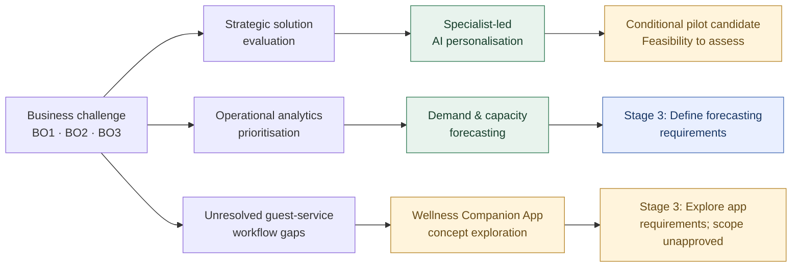

# 02 — Strategy & Solution Evaluation

**Pinnacle Wellness Resort | Independent Business Analysis Portfolio Case Study | 2026**  
*Fictional business scenario. All decisions below are portfolio recommendations, not client approvals or implemented solutions.*  
**Previous:** [01 — Business Discovery](01-business-discovery.md)

## 1. Business Decision Context

Pinnacle's central challenge is **fragmented guest information and difficult coordination between personalised treatment demand and specialist capacity**. The business must identify which changes deserve further analysis while preserving specialist-led service.

Evaluation criteria are **BO1 — information continuity**, **BO2 — scheduling efficiency** and **BO3 — personalised experience**, considered alongside business value, data readiness, feasibility and risk.

### Decision Path

*These are related but distinct analytical paths. Forecasting is prioritised for requirements definition; personalisation remains conditional; the app is an exploratory concept arising from unresolved service gaps—not a chosen implementation of either initiative.*

## 2. Strategic Solution Evaluation

### Key SWOT Findings

- **Strength:** Specialist wellness expertise underpins premium personalised services.
- **Weaknesses:** Fragmented guest information and complex specialist scheduling constrain coordination.
- **Opportunities:** AI-assisted personalisation and demand analytics could improve experience and planning.
- **Threats:** Rising digital expectations and privacy risks increase the consequences of ineffective change.

### TOWS — Turning Findings into Options

| Strategic option | Logic | Principal trade-off |
|---|---|---|
| **Specialist-Led AI Personalisation** *(strength × opportunity)* | Combine specialist judgement with AI-supported recommendations to improve relevance and differentiation (**BO3**). | Depends on trusted, authorised guest data (**BO1**), privacy safeguards and specialist review. |
| **Predictive Demand & Capacity Planning** *(weakness × opportunity)* | Use demand forecasts to support therapist allocation and operational planning (**BO2**). | A narrower potential starting point, but forecast quality and capacity data limit usefulness. |

**Strategic recommendation:** Retain **specialist-led personalisation** as a *conditional* longer-term direction, subject to a bounded feasibility assessment and specialist oversight. Pursue capacity planning as a separate operational opportunity; choosing a direction does not approve a pilot.

## 3. Operational Analytics Opportunity Evaluation

Three analytics opportunities were assessed for problem fit, potential business value, data availability, complexity and usefulness to operational decisions.

| Opportunity | Decision rationale | Relative priority |
|---|---|---|
| **Guest Return-Risk Prediction** | Could inform retention activity, but depends on reliable visit histories and is less directly relevant to treatment capacity. | Second |
| **Treatment Demand & Therapist Capacity Forecasting** | Could inform expected bookings, treatment hours and staffing decisions (**BO2**); depends on booking history and therapist availability data. | **First — advance to requirements analysis** |
| **Guest Wellness Segmentation** | Could support tailored programmes (**BO3**), but offers less immediate value for scheduling decisions. | Third |

**Operational recommendation:** Prioritise forecasting for detailed analysis because of its direct connection to capacity decisions and moderate *estimated* complexity. The ranking is qualitative; no benefits or technical feasibility have been measured.

## 4. Business Objective Coverage & Remaining Gaps

| Objective | Contribution of proposed directions | Unresolved need |
|---|---|---|
| **BO1 — Information continuity** | Authorised access to guest information would support informed recommendations and staff decisions. | Data quality, permissions and interoperability remain unverified; no integrated guest-data solution has been selected. |
| **BO2 — Scheduling efficiency** | Forecasting could improve demand and workforce planning. | A forecast is **not** a real-time availability check, treatment reservation or booking confirmation. |
| **BO3 — Personalised experience** | Specialist-led recommendations could increase service relevance. | Guest-facing schedule interactions, recommendation suitability and professional oversight need requirements analysis. |

**Scope implication:** Forecasting addresses an operational planning decision, but does not close the guest-facing workflow gaps. A **Wellness Companion App** is therefore retained as a **separately scoped concept for requirements exploration**, not as a second approved solution or an assumed integration with forecasting.

## 5. Feasibility & Decision Gates

**Personalisation — before any pilot:** Assess guest-data reliability, consent and role-based access, recommendation suitability, specialist review workload and privacy controls.

**Forecasting — during requirements definition and before development:** Examine booking-history coverage, therapist availability and capacity records, refresh/integration feasibility, forecast outputs and how managers would use them. Identify baseline measures before claiming improvements.

**Guest app concept — before confirming solution scope:** Validate guest and staff workflow needs, profile-data permissions, booking/availability rules, external recommendation-service dependencies and any required professional approval.

**Decision:** Move **forecasting** into detailed requirements analysis. Keep **personalisation** conditional and the **guest app** exploratory. These checks have been identified, **not completed or approved**.

## 6. Handover to Stage 3 — Requirements Analysis & Prioritisation

Stage 3 will develop two **separately traceable requirements scopes** within the same business case:

| Scope | Why it enters Stage 3 | Requirements questions to resolve |
|---|---|---|
| **A. Demand & capacity decision support — prioritised** | The strongest assessed operational opportunity (**BO2**). | What booking and availability data are needed? What forecast horizons, treatment categories and capacity views support staff decisions? How should forecast-versus-actual performance be assessed? |
| **B. Wellness Companion App — exploratory** | A distinct concept for unmet guest-facing personalisation and scheduling needs (**BO1–BO3**). | What guest profile and schedule interactions are in scope? Who reviews sensitive or AI-generated recommendations? How is actual appointment availability checked and a booking confirmed or rejected? |

**Planned analysis deliverables:** stakeholder needs mapped to candidate requirements (**House of Quality** where useful), **MoSCoW priorities**, clear business rules, user stories and acceptance criteria, plus a **requirements traceability matrix** linking the two scopes to BO1–BO3. The app's inclusion in modelling is **not** evidence that its implementation was selected.

**Boundary for subsequent design:** Forecasting supports *planning*; the guest app concerns *service interaction and booking workflows*. No live data integration, shared platform, stakeholder sign-off, deployment or realised business benefit is asserted.
