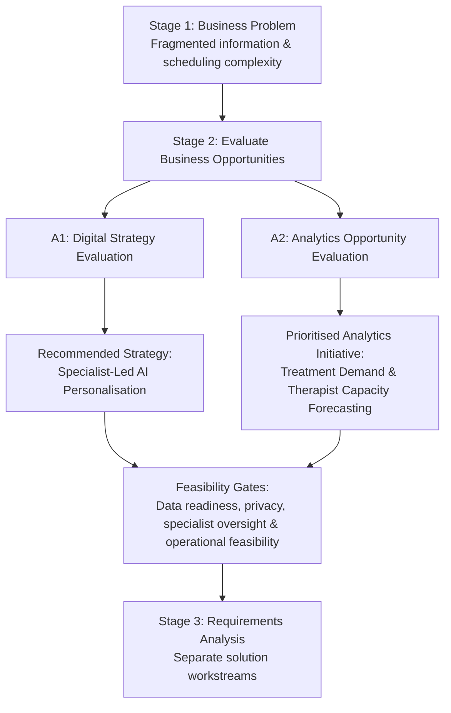

# 02 — Strategy & Solution Evaluation

**Pinnacle Wellness Resort | Deakin University academic case study | 2026**  
**Status:** Proposed strategic and analytics recommendations; not approved investments or implemented solutions.  
**Previous stage:** [01 — Business Discovery](01-business-discovery.md)

### Solution Evaluation & Decision Flow

*The two recommendations address different business priorities. Both remain proposals subject to feasibility validation, not approved or implemented solutions.*

## 1. Business Decision Context

Stage 1 established one challenge: **fragmented guest information and difficult coordination between personalised treatment demand and specialist capacity**. Pinnacle needed to prioritise investment without weakening specialist-led service.

Evaluation criteria: **BO1 — information continuity; BO2 — scheduling efficiency; BO3 — personalised experience**, alongside value, feasibility, data readiness and risk.

## 2. Digital Strategy Evaluation — A1

A1 used SWOT/TOWS to compare **Specialist-Led AI Personalisation** with **Predictive Demand and Capacity Planning**.

**Preferred strategic direction: Specialist-Led AI Personalisation.** Uses specialist expertise to improve personalised recommendations (**BO3**) and guest differentiation, contingent on authorised, reliable information (**BO1**) and specialist review.

**Alternative: Predictive Demand and Capacity Planning.** Addresses capacity decisions (**BO2**) through a narrower, more reversible pilot, potentially delivering earlier operational value but less guest-facing differentiation. Forecast errors threaten service flexibility.

**Decision:** Prioritise personalisation strategically, conditionally on a bounded pilot and governance controls. Capacity planning remains separate; scheduling and integration gaps persist.

## 3. Business Analytics Opportunity Evaluation — A2

A2 compared three initiatives for value, problem fit, data availability, complexity and operational usefulness.

| Opportunity | Business case and dependencies | A2 priority |
|---|---|---|
| **BP1 — Guest Return-Risk Prediction** | Could target retention; needs reliable revisit histories and offers less direct scheduling value. | **Second** |
| **BP2 — Treatment Demand & Therapist Capacity Forecasting** | Forecasts bookings and treatment hours for staffing decisions (**BO2**); needs booking and therapist-availability data. | **First — selected for requirements analysis** |
| **BP3 — Guest Wellness Segmentation** | Could tailor wellness programmes (**BO3**); less directly useful for scheduling. | **Third** |

**Decision:** Advance BP2: high assessed operational usefulness and alignment, moderate estimated complexity. Rankings remain unvalidated academic judgements.

## 4. Objective Coverage & Remaining Gaps

| Objective | Proposed response and expected value | Unresolved dependency or gap |
|---|---|---|
| **BO1 — Information continuity** | Authorised access supports personalisation; A1 also explored a **separate analytics query tool**. | No integrated data solution selected; assess quality, access and interoperability. |
| **BO2 — Scheduling efficiency** | BP2 could improve demand and capacity planning. | Forecasting does **not** guarantee live availability or booking confirmation. |
| **BO3 — Personalised experience** | A1's specialist-led direction could improve relevance and consistency. | Recommendation quality and specialist workload remain untested. |

## 5. Feasibility, Risks & Decision Gates

Before funding or piloting, validate **data readiness**, privacy/consent, access controls, specialist oversight, workflow feasibility, cost and BO1–BO3 baselines.

**Proposed next decision:** Progress **BP2** to detailed requirements; retain **personalisation** for pilot consideration. Feasibility gates are **portfolio refinements**, not completed checks.

## 6. Handover to Stage 3 — Requirements Analysis

Carry forward separate scopes: **BP2 forecasting requirements** and the later A3 **Wellness Companion App models**. Clarify data, user decisions, exceptions and acceptance criteria against BO1–BO3. Neither solution was integrated or deployed.

*Sources: MIS701 A1 §§2.2–2.5; MIS701 A2 opportunity matrix, value–complexity assessment and recommendation; approved Stage 1. Benefits remain proposed.*
