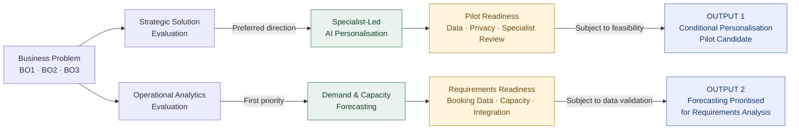

# 02 — Strategy & Solution Evaluation

**Pinnacle Wellness Resort | Independent Business Analysis Portfolio Case Study | 2026**

*Fictional business scenario. Recommendations are proposed, not approved investments or implemented solutions.*

**Previous:** [01 — Business Discovery](01-business-discovery.md)

## 1. Business Decision Context

Pinnacle's challenge is **fragmented guest information and difficult coordination between personalised treatment demand and specialist capacity**. The decision is what to prioritise without weakening specialist-led service.

Options were assessed against **BO1 — information continuity**, **BO2 — scheduling efficiency** and **BO3 — personalised experience**, alongside value, feasibility, data readiness and risk.

### Decision Path

*Both outputs are proposed decisions subject to feasibility validation. They represent distinct solution directions, not approved investments or an integrated delivery programme.*

## 2. Strategic Solution Evaluation

### Key SWOT Findings

- **Strength:** Specialist wellness expertise supports premium, personalised services.
- **Weaknesses:** Fragmented guest information and complex appointment scheduling limit service coordination.
- **Opportunities:** AI personalisation and predictive analytics offer potential service and operational improvements.
- **Threats:** Rising digital expectations and potential privacy exposure increase the risks of inaction or poorly governed change.

### Strategy Development — TOWS

Two strategic directions emerged:

**Strategy 1 — Specialist-Led AI Personalisation (Strength × Opportunity)**

Leverage specialist expertise with AI-supported recommendations to strengthen personalised guest experiences (BO3).

**Strategy 2 — Predictive Demand & Capacity Planning (Weakness × Opportunity)**

Use demand forecasting to support therapist allocation and appointment planning (BO2).

### Comparative Evaluation & Decision

Personalisation offers stronger guest-facing differentiation but requires reliable guest information, privacy controls and specialist oversight.

Capacity planning offers more immediate operational value, with a narrower and potentially more reversible implementation scope.

**Decision:** Prioritise specialist-led personalisation as the conditional strategic direction, supported by a bounded pilot. Retain demand and capacity planning as a separate operational opportunity.

## 3. Operational Analytics Opportunity Evaluation

Three opportunities were compared on business value, problem fit, data availability, complexity and operational usefulness.

| Opportunity | Decision rationale | Priority |
|---|---|---|
| **Guest Return-Risk Prediction** | May support retention interventions; less direct relevance to treatment capacity and dependent on reliable visit history. | Second |
| **Treatment Demand & Therapist Capacity Forecasting** | Supports booking-volume, treatment-hours and workforce-planning decisions; requires consistent booking and therapist-capacity data. | **First — selected for detailed requirements** |
| **Guest Wellness Segmentation** | Could support tailored programmes, but offers less direct support for immediate scheduling decisions. | Third |

**Operational decision:** Prioritise forecasting because of its strong assessed problem fit and operational usefulness, with moderate estimated complexity. These are preliminary assessments, not measured outcomes.

## 4. Objective Coverage & Remaining Gaps

| Objective | Proposed capability and potential value | Unresolved gap |
|---|---|---|
| **BO1 — Information continuity** | Authorised access to relevant guest information could support more consistent decisions; an operational analytics query capability was also considered. | No integrated data solution confirmed; information quality, access and interoperability require assessment. |
| **BO2 — Scheduling efficiency** | Forecasting could improve demand and therapist-capacity planning. | Forecasts do not establish live availability or guarantee successful appointment bookings. |
| **BO3 — Personalised experience** | Specialist-led recommendations could support more relevant services. | Recommendation suitability, guest acceptance and specialist workload are unvalidated. |

## 5. Feasibility & Decision Gates

**Personalisation:** Assess guest-data readiness, consent and access arrangements, recommendation suitability, specialist approval and operational workload before a pilot.

**Forecasting:** Verify historical booking coverage, therapist availability, data integration and meaningful forecast-performance measures before development.

**Decision:** Progress forecasting to requirements analysis. Keep personalisation as a strategic direction subject to a controlled feasibility assessment. Neither choice constitutes funding approval or production delivery.

## 6. Handover to Requirements Analysis

The next stage will specify **forecasting and capacity-visibility requirements**. A **separately scoped Wellness Companion App** will also be analysed for personalised guest interactions and scheduling; its scope is related to the strategic direction, **not an implementation of the forecasting initiative**.

Each workstream needs separately traceable requirements, business rules and acceptance criteria. Booking validation, interoperability and specialist review remain open design questions.

*Evidence basis: original university case analysis and subsequent independent portfolio refinement. No live stakeholder validation, integration, deployment or realised benefits are claimed.*
