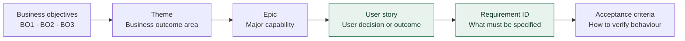
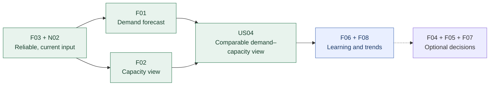
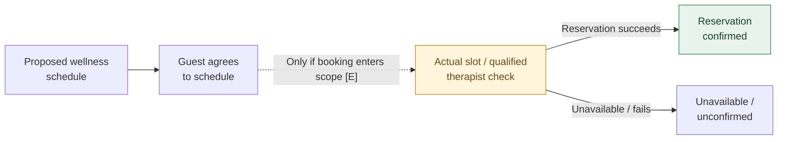

# 03 — Requirements Analysis & Prioritisation

**Pinnacle Wellness Resort | Independent Business Analysis Portfolio Case Study | 2026**  
*Fictional business scenario. This is a proposed requirements baseline, not a client-approved specification or evidence of delivered functionality.*  
**Previous:** [02 — Strategy & Solution Evaluation](02-strategy-and-solution-evaluation.md) · **Next:** 04 — Business Process & Solution Modelling *(planned)*

## 1. Requirements Decision & Scope

Stage 2 prioritised **treatment-demand and therapist-capacity decision support** as the first operational opportunity for requirements analysis (**BO2**). It also identified dependencies on reliable information (**BO1**) and unresolved guest-facing personalisation and scheduling needs (**BO3**, **BO2**).

**Scope decision:** Define the **operational forecasting requirements in detail**; capture **guest-app requirements as a separate, exploratory workstream**, not as a second approved build or an assumed integration.

| Workstream | Business decision supported | Requirements boundary |
|---|---|---|
| **Primary — Demand & Capacity Decision Support** | Can operations staff anticipate treatment demand and compare it with therapist capacity? | Forecasts, capacity views and supporting data quality; **no booking confirmation or automatic rostering** |
| **Exploratory — Wellness Companion App** | How could guests safely request, review and respond to personalised schedules? | Guest profile, recommendations, schedule states; live booking and specialist approval remain **scope/policy decisions** |
| **Deferred / excluded** | Separate solution or implementation decisions | Cross-system integration between workstreams, production deployment, payment and complete meal-order workflows |

**Evidence legend:** **[S]** = supported by the existing case analysis or diagrams; **[I]** = reasoned inference requiring validation; **[E]** = independent portfolio enhancement. Source-supported **does not** mean stakeholder-approved. All backlog priorities are **proposed**.

## 2. From Stakeholder Needs to Requirements

| Stakeholder / role | Decision or need | BO | Requirement connection |
|---|---|---|---|
| **Resort Operations Manager** | Anticipate treatment demand; compare forecast service hours with available specialist capacity | BO2 | F01–F03, F06, F08 **[S]** |
| **Therapist / wellness professional** | Understand assigned workload and avoid inappropriate scheduling expectations | BO2 | F02, F05; role-specific view requires confirmation **[S/I]** |
| **Front Desk** *(assumed operational role)* | Offer genuinely available appointment times, not forecast-based promises | BO2 | **W05 [E]**, not a capability proven by F01 |
| **Guest** | Supply relevant profile details; receive and respond to a proposed wellness schedule | BO1, BO3 | W01–W04 **[S]** |
| **IT / data support** *(conditional role)* | Identify missing, incomplete or stale booking and capacity inputs | BO2 | F03, N02 **[S/I]** |
| **Authorised wellness specialist** | Review specific recommendations if professional-approval rules require it | BO3 | W06 **[E]**, approval categories TBD |

*These needs are interpreted from a fictional case; no real stakeholder interviews or approvals are claimed.*

### Focused House of Quality (HoQ) findings

The existing forecasting HoQ relates stakeholder needs to eight operational system requirements. Its most useful insight for this stage is a **dependency**, not a decorative score: **data integration (F03)** supports **demand forecasting (F01)** and **therapist-capacity visibility (F02)**; forecast learning and demand trends follow.

| Stakeholder need (WHAT) | Important requirements (HOW) | Requirements implication |
|---|---|---|
| Anticipate treatment bookings and service hours | **F01 + F03** | Define booking history, treatment duration, period and forecast units |
| Understand therapist capacity | **F02 + F03** | Define available service hours and specialisation from actual availability records |
| Identify potential staffing gaps | **F01 + F02 + F03** | Align the time period and service-hour basis before comparing values |
| Interpret forecast changes and performance | **F06 + F08** | Enable follow-up variance and trend analysis after the core is credible |

*This is a selective, qualitative HoQ extract. It does not recalculate or invent relationship weights, adopt source targets as contractual thresholds, or assign the forecasting HoQ to the guest app.*

## 3. Requirements Backlog — Theme → Epic → User Story

The backlog is the **central navigation artefact**: a reader can trace a business capability to a user story, candidate requirements and the acceptance checks below. The primary workstream retains the **two themes and three epics** from the documented forecasting analysis; wording is refined where needed for clarity and scope control.

### Primary backlog — operational forecasting and capacity planning

| Theme | Epic | User story and user value | Linked requirements | Scope / test link |
|---|---|---|---|---|
| **T1 — Predictive Demand & Capacity Planning** | **E1 — Treatment Demand Forecasting** | **US01 — Forecast demand:** As resort management, I want predicted bookings and treatment hours by treatment type and period so I can anticipate resource needs. | F01, F03 | **Core** · AC01–02 |
| T1 | E1 | **US02 — Peak periods:** As an Operations Manager, I want to identify predicted peak and quieter periods so I can consider staffing adjustments. | F01, F08 | **Should** · trend detail later |
| T1 | **E2 — Therapist Capacity Planning** | **US03 — Capacity visibility:** As an Operations Manager, I want available therapist service hours by specialisation and defined period so I can understand capacity before staffing decisions. | F02, F03 | **Core** · AC03 |
| T1 | E2 | **US04 — Demand–capacity comparison:** As an Operations Manager, I want forecast treatment hours compared with available therapist hours for matching periods so I can recognise planning gaps. | F01–F03 | **Core** · AC04 |
| **T2 — Operational Decision Support & Reliable Delivery** | **E3 — Operational Decision Support & Data Reliability** | **US05 — Capacity alerts:** As an Operations Manager, I want to see material forecast–capacity differences so I can review possible staffing responses. | F04 | **Could** · threshold TBD |
| T2 | E3 | **US06 — Appointment availability:** As a Front Desk Receptionist, I want to view actually available treatment times so I can offer guests credible options. | W05 **[E]**, live-booking source TBD | **Scope gate** · AC09; **not** supplied by forecast data |
| T2 | E3 | **US07 — Workload view:** As a Therapist, I want to see my assigned appointments and scheduled hours so I can identify potential overbooking. | F05 *(partial linkage)*; additional operational source may be needed **[I]** | **Could / scope gate** · rule TBD |
| T2 | E3 | **US08 — Data freshness:** As an IT/data support user, I want booking and availability refresh status so I can identify unreliable inputs before reports are used. | F03, N02 | **Core control** · AC05 |

**Scope correction:** The eight story topics come from the original forecasting analysis, but **US06 is a transactional appointment-availability need** and cannot be satisfied merely by the forecasting capability. **US07** needs a per-therapist operational schedule source beyond an aggregate utilisation report. Both are retained visibly as **scope questions**, rather than silently promised in the forecasting solution.

### Supporting backlog — exploratory personalised guest journey

| Theme | Epic | User story and user value | Linked requirements | Scope / test link |
|---|---|---|---|---|
| **T3 — Personalised Guest Journey** | **E4 — Guest Profile & Schedule** | **US09 — Complete profile:** As a Guest, I want to provide missing required wellness details so a relevant schedule can be requested. | W01 | **Exploratory [S]** · AC06 |
| T3 | E4 | **US10 — Obtain recommendations:** As a Guest, I want to request a personalised schedule and see a clear failure state if recommendations cannot be obtained. | W02, W04 | **Exploratory [S]** · AC07 |
| T3 | E4 | **US11 — Respond to schedule:** As a Guest, I want to review and respond to a proposed wellness schedule so its status is clear. | W03 | **Exploratory [S]** · AC08 |
| T3 | **E5 — Booking Assurance & Specialist Oversight** | **US12 — Confirm actual reservation:** As booking staff, I want appointment availability and a reservation outcome checked before claiming a treatment is booked. | W05 | **Enhancement / scope gate [E]** · AC09 |
| T3 | E5 | **US13 — Professional review:** As an authorised specialist, I want to review recommendations that require professional sign-off before guests receive them. | W06 | **Enhancement / policy gate [E]** · AC10 |

*The guest-app epic/story organisation is a portfolio refinement, not an existing approved backlog. US06 and US12 describe the same unmet booking-control need from different user contexts; **they do not imply two systems or duplicate delivery commitments**.*

## 4. Candidate Requirements & MoSCoW Decisions

### Primary capability — forecast and capacity decision support

| ID | Testable requirement statement | BO | Priority | Evidence |
|---|---|---|---|---|
| **F01** | Produce forecast booking counts and required treatment hours by treatment type and selected planning period. | BO2 | **Must** | [S] |
| **F02** | Display therapist availability and capacity by specialisation and comparable period. | BO2 | **Must** | [S] |
| **F03** | Obtain booking and therapist-availability data from specified sources and indicate freshness, missing inputs and failed refreshes. | BO2 | **Must** | [S] + status clarification [E] |
| **F04** | Display an alert when demand–capacity variance exceeds an agreed threshold. | BO2 | Could | [S] |
| **F05** | Report treatment workload and therapist utilisation over selected periods; a personal daily schedule is **not automatically included**. | BO2 | Could | [S] |
| **F06** | Compare historic forecasts and actual bookings by treatment type and period. | BO2 | Should | [S] |
| **F07** | Support read-only exploration of alternative therapist-allocation scenarios. | BO2 | Could | [S] + read-only boundary [E] |
| **F08** | Present demand trends by treatment type and period. | BO2 | Should | [S] |

**Proposed minimum coherent capability:** **F03 → F01 + F02**, including an aligned read-only comparison (US04). Forecast-versus-actual and trends (**F06/F08**) follow once core data are reliable. Alerts, workload reports and scenario planning (**F04/F05/F07**) are optional. **Won't Have for this scope:** live appointment reservation, automated rostering and integrations between the two workstreams.

### Exploratory app capability — priorities apply only if the concept is approved

| ID | Candidate requirement | BO | Conditional priority | Evidence |
|---|---|---|---|---|
| **W01** | Check required guest-profile information and request missing details before recommendation generation. | BO1, BO3 | Must *within proposed app scope* | [S] |
| **W02** | Request external recommendations using permitted profile/activity data and validate the response before assembling a proposed schedule. | BO1, BO3 | Must *within proposed app scope* | [S] |
| **W03** | Record separate guest-response outcomes for a proposed wellness schedule: guest-confirmed, unconfirmed/expired or failed generation. | BO3 | Must *within proposed app scope* | [S] |
| **W04** | Report external recommendation unavailability without issuing a false confirmed schedule. | BO3 | Must *within proposed app scope* | [S] |
| **W05** | Check current appointment and qualified therapist availability and record a separate reservation success/failure outcome. | BO2 | **Must if transactional booking confirmation enters scope; otherwise Won't Have** | [E] |
| **W06** | Hold specified recommendation categories for authorised specialist review and record approval/rejection before release. | BO3 | **Must if applicable approval policy requires it; otherwise policy TBD** | [E] |

**Priority correction:** W05 is not merely “Should”. If the business decides the app will **confirm actual bookings**, a successful live availability/reservation check is a necessary control. If the app is only a wellness-*schedule* confirmation tool, W05 stays out of that narrower scope. **A scope decision must precede its MoSCoW rating.**

### Non-functional requirements and controls

| ID | Candidate control | Verification / unresolved target |
|---|---|---|
| **N01** | Restrict guest, therapist and management data by authorised role and purpose. | Access matrix TBD; prohibited requests must disclose no protected data |
| **N02** | Show missing, stale and failed source-data states and qualify affected outputs. | Freshness thresholds and source ownership **TBD** |
| **N03** | Apply consent, retention and privacy requirements to identifiable wellness information. | Permitted fields, retention periods and consent rules **TBD** |
| **N04** | Explain forecast units, periods, calculation basis and refresh status in understandable terms. | Usability criteria and operational review **TBD** |
| **N05** | Retain meaningful schedule/booking/review states and exceptions for authorised investigation. | Audit fields and retention **TBD** |

No forecast accuracy, uptime, processing-time or refresh target is asserted as an approved performance standard. Existing numerical suggestions need stakeholder/data-owner review.

### Requirements dependency map

*Logical dependency, not an approved development schedule. The app is deliberately absent: cross-workstream integration has not been established.*

## 5. Story Refinement, Acceptance Criteria & INVEST

### An evidence-based INVEST example

The original capacity-visibility story was too broad around **“period”**, **“capacity”** and possible staffing-allocation actions. Its earlier numeric INVEST assessment identified weak **Estimable, Small and Testable** aspects. The following **qualitative refinement** makes the story easier to evaluate without implying a development-team estimate:

> **Before:** “As an Operations Manager, I want to view therapist availability and capacity by specialisation and period so I can understand available service capacity before making staffing decisions.”
>
> **After — US03:** “As an Operations Manager, I want a **read-only view of available therapist service hours by specialisation for a selected, bounded period**, so I can understand capacity before making staffing decisions.”

| INVEST check | Reasoned result for refined US03 |
|---|---|
| **Independent** | The read-only capacity view has a distinct outcome; dependency on F03 is transparent. |
| **Negotiable** | Layout and filters remain open to user feedback. |
| **Valuable** | Supports BO2 staffing and capacity decisions. |
| **Estimable** | Period, available-hour calculation and source definitions still need confirmation. |
| **Small** | Excludes forecasting, automatic roster changes and appointment booking. |
| **Testable** | Source-matched available hours and refresh status can be checked (AC03). |

**Why no numeric INVEST score here?** The source recorded scores for selected stories, but scores are **diagnostic indicators of story quality**, not business-value ranking or delivery approval. Demonstrating the issue, refinement and acceptance test is more persuasive than inventing or reproducing an arbitrary new score.

### Acceptance criteria — representative success and exception paths

| ID / story | Given | When | Then |
|---|---|---|---|
| **AC01 / US01** | Usable booking history and agreed treatment durations exist | An authorised manager requests a forecast by treatment and period | Show expected booking count, service hours, period, units and source refresh status |
| **AC02 / US01** | Required forecast inputs are missing, invalid or beyond an agreed freshness tolerance | The forecast is requested | Identify the affected data and do **not** present an unqualified current forecast |
| **AC03 / US03** | Therapist availability records exist for a selected specialisation and bounded period | A manager opens the capacity view | Show available service hours matching source records and the last refresh time; make no automatic allocation |
| **AC04 / US04** | Forecast and capacity values use the same specialisation, period and hour definitions | A manager compares the values | Show both figures and their planning variance; do **not** label it a live appointment clash |
| **AC05 / US08** | A scheduled booking or capacity-data refresh has failed | An authorised data-support user checks data status | Show failed source, last successful refresh and affected outputs; do not hide the failure |
| **AC06 / US09** | A guest profile lacks a required item | The guest requests a personalised schedule | Request the missing item before sending the recommendation request |
| **AC07 / US10** | The external AI recommendation service times out or returns unusable data | The app attempts schedule creation | Report a failed/unavailable schedule-generation state without recording confirmation |
| **AC08 / US11** | A proposed schedule is available and a response window exists | The guest confirms or the window expires | Record **guest-confirmed** or **unconfirmed/expired** schedule status, **not** reservation confirmation |
| **AC09 / US12** | A real appointment booking is in scope and a treatment/time is requested | Live slot, qualified therapist and reservation outcome are checked | Say **booked** only after reservation success; otherwise show unavailable/unconfirmed **[E]** |
| **AC10 / US13** | A recommendation belongs to a category requiring professional approval | A guest would otherwise receive it | Keep it pending until an authorised specialist records approval/rejection **[E]** |
| **AC11 / N01** | A user is not permitted to access another guest's or therapist's protected details | The user requests those details | Deny the request without disclosing protected fields; log as required by the access policy **[I]** |

*These are **proposed acceptance criteria**, not test results. Exact forecast periods, freshness thresholds, role permissions and approval categories remain TBD.*

## 6. Business Rules & Critical Scope Distinctions

| Rule | Candidate rule | Basis |
|---|---|---|
| **BR01** | A demand–capacity comparison must use compatible units, time windows and treatment/specialisation definitions. | [I] |
| **BR02** | Forecast demand must never be represented as live slot availability. | [E] clarification |
| **BR03** | Guest acceptance of a **wellness schedule** is not evidence of an actual **treatment reservation**. | [E] clarification |
| **BR04** | Incomplete required profile data or a failed recommendation service must not create a confirmed schedule. | [S] |
| **BR05** | Recommendations subject to a defined professional-approval policy must remain pending until the authorised decision. | [E] |
| **BR06** | Personally identifiable guest and staff information must be disclosed only to authorised roles. | [S/I] |

### Schedule agreement is not a reservation

*Dashed linkage and reservation checks are **proposed enhancements**, not behaviour established in the existing guest-schedule confirmation models.*

## 7. Traceability & Coverage Decisions

A useful trace connects an outcome to a user decision and observable behaviour. The backlog in Section 3 maps **Theme → Epic → User Story → Requirement**; this table completes the chain through business objectives and acceptance checks without duplicating every story.

| Objective / need | Epic → story | Requirement | Evidence of acceptance | Expected value / open validation |
|---|---|---|---|---|
| **BO2 — anticipate treatment demand** | E1 → US01 | F01, F03 | AC01–02 | Qualified forecast to inform resource planning; predictive performance unvalidated |
| **BO2 — understand usable capacity** | E2 → US03, US04 | F01–F03 | AC03–04 | Comparable service hours to identify planning gaps |
| **BO2 — trustworthy planning inputs** | E3 → US08 | F03, N02 | AC05 | Avoid capacity decisions using hidden stale inputs |
| **BO2 — service availability clarity** | E3 → US06; E5 → US12 | W05 *only if scoped* | AC09 **[E]** | Prevent false booking confirmation; source integration unverified |
| **BO1/BO3 — relevant guest data and schedules** | E4 → US09–US11 | W01–W04 | AC06–08 | Clear guest input and schedule states; app unapproved |
| **BO3 — professional oversight** | E5 → US13 | W06 | AC10 **[E]** | Guard specialist-review decisions; policy undefined |
| **BO1 — authorised data use** | Cross-cutting | N01, N03 | AC11 + privacy-policy checks TBD | Reduce inappropriate disclosure; controls not validated |

**Coverage gaps:** BO1 still lacks a selected end-to-end guest information-continuity solution. BO2 forecasting addresses *planning*, not reservations. BO3 remains conditional on app feasibility and specialist-governance decisions. Coverage of these objectives is **partial**, not proof of benefit realisation.

## 8. Open Decisions & Stage 4 Modelling Handover

| Decision to validate | Why it affects requirements | Suggested Stage 4 model |
|---|---|---|
| Historical booking completeness, treatment durations and forecast granularity | F01 may otherwise provide misleading demand hours | **BPMN (proposed forecasting decision flow)** with input-validation exceptions |
| Therapist specialisations, actual availability and unit definitions | F02/US04 comparisons require compatible capacity records | **Use case/specification** for capacity view and comparison |
| Read-only forecast versus transactional booking scope | US06/US12 and W05 cannot be smuggled into forecast delivery | **Separate BPMN To-Be booking flow** *only if* scope accepted |
| Guest profile, external recommendation failures and confirmation expiry | W01–W04 contain meaningful exception states | **Sequence diagram + BPMN** for proposed schedule request/confirmation |
| Meaning and ownership of Guest, WellnessProfile, Recommendation, WellnessSchedule and TreatmentBooking | Prevents treating a schedule as a reservation | **Domain class diagram** with distinct entities and states |
| Approval categories, consent and access roles | W06/N01/N03 may block release or disclosure | **Business-rule decision table** and authorisation scenarios |

**Recommended Stage 4 emphasis:** Model the **forecasting data-to-decision workflow** first; model the **guest-schedule interaction separately**, using existing UML/BPMN case material as the analytical starting point. Clearly mark any inferred *As-Is* process and proposed *To-Be* change. Do not imply either system was integrated, deployed or validated with real stakeholders.

**Requirements status:** Working portfolio baseline for modelling and review; not signed off. The next business decisions are **data readiness, reservation scope and specialist-approval policy**.
