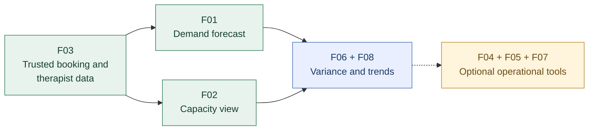
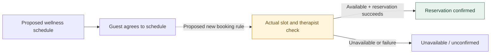

# 03 — Requirements Analysis & Prioritisation

**Pinnacle Wellness Resort | Independent Business Analysis Portfolio Case Study | 2026**  
*Fictional business scenario. Candidate requirements and priorities are analytical proposals, not stakeholder-approved specifications or delivered functionality.*  
**Previous:** [02 — Strategy & Solution Evaluation](02-strategy-and-solution-evaluation.md)

## 1. From Business Decisions to Requirements Scope

[Stage 2](02-strategy-and-solution-evaluation.md) identified **treatment-demand and therapist-capacity forecasting** as the first operational initiative for requirements analysis. It also retained specialist-led personalisation as a conditional strategic direction and identified unresolved guest information and booking-workflow gaps.

**Requirements decision:** Develop a **detailed baseline for operational demand and capacity decision support**, and a **limited exploratory baseline for a separately proposed Wellness Companion App**. The two concepts share business objectives but are **not assumed to exchange data or form one approved product**.

| Scope | Decision supported | Business alignment | Boundary |
|---|---|---|---|
| **Primary: Demand & Capacity Decision Support** | Can managers anticipate treatment demand, understand available therapist capacity and plan staffing? | **BO2**, enabled by reliable operational information | Forecasting and decision support, **not booking confirmation** |
| **Supporting: Wellness Companion App concept** | Can guests safely review personalised schedules and understand whether treatment appointments are actually booked? | **BO1–BO3** | Candidate guest-facing interactions and rules, **not an approved app build** |
| **Deferred** | Production model training/deployment, automated rostering, cross-product integration, payment and full meal-ordering workflows | Not needed to answer this stage's central requirements questions | Outside this candidate baseline |

**Evidence convention:** **[S]** supported by prior case analysis or documented models; **[I]** reasoned inference requiring stakeholder confirmation; **[E]** independent portfolio enhancement filling an identified gap. **[S] does not mean validated by real stakeholders.** All MoSCoW ratings below are proposed planning judgements.

## 2. Stakeholder Needs → Solution Requirements

| Stakeholder | Business need / decision | Objective | Candidate requirements | Basis |
|---|---|---|---|---|
| Resort Operations Manager | Anticipate booking demand, compare it with therapist capacity and investigate mismatches | BO2 | F01, F02, F03, F06 | [S] |
| Therapists / wellness professionals | See assigned workload without losing professional judgement | BO2, BO3 | F02; W06 | [S]/[E] |
| Front desk / booking staff *(assumed user role)* | Communicate genuinely bookable appointment options | BO2 | W05 | [I]/[E] |
| Guests | Use relevant information to review a personalised schedule; know the outcome of their response | BO1, BO3 | W01–W04 | [S] |
| Technology / data support *(conditional role)* | Identify gaps, stale records and access restrictions affecting decisions | BO1, BO2 | F03, N01–N03 | [I] |
| Authorised wellness specialists | Check sensitive or unsuitable recommendations before release when policy requires | BO3 | W06 | [E] |

No interviews, workshops or sign-offs with these stakeholders are claimed. Roles inferred from the scenario require confirmation before delivery decisions.

### Focused House of Quality interpretation

The earlier forecasting analysis translated operational needs into eight system requirements. Its central conclusion was that **booking/availability data (F03)**, **demand forecasting (F01)** and **therapist-capacity visibility (F02)** are the core capabilities; forecast monitoring and demand trends follow. The compact extract below expresses **need-to-requirement relationships**, not a recalculated HoQ score.

| Priority stakeholder need | Requirement linkage | Requirements consequence |
|---|---|---|
| Forecast bookings and required treatment hours | **F01**, dependent on **F03** | Reliable historical/current booking inputs precede meaningful forecast output |
| See capacity by specialisation and period | **F02**, dependent on **F03** | A capacity view must use therapist availability, not predicted bookings |
| Compare anticipated demand and available capacity | **F01 + F02 + F03** | Managers need both views aligned to comparable periods and treatment types |
| Recognise forecast error and changing patterns | **F06 + F08** | Improvement and trend views follow a working core |

The original HoQ's quantitative target values are **not adopted as approved service-level commitments**. This forecasting HoQ does **not** prioritise the separate app concept.

## 3. Functional Requirements & MoSCoW Decisions

### A. Primary baseline — operational decision support

| ID | Candidate requirement | BO | MoSCoW | Basis |
|---|---|---|---|---|
| **F01** | Forecast treatment booking counts and required service hours by treatment type and agreed time period, using booking history. | BO2 | **Must** | [S] |
| **F02** | Show therapist availability and capacity by specialisation and agreed time period for operational comparison. | BO2 | **Must** | [S] |
| **F03** | Obtain relevant booking and therapist-availability records from designated sources; expose data currency and missing inputs. | BO1, BO2 | **Must** | [S] + [E] freshness visibility |
| **F04** | Flag demand–capacity differences exceeding a configurable decision threshold. | BO2 | Could | [S] |
| **F05** | Provide treatment workload and therapist-utilisation reports. | BO2 | Could | [S] |
| **F06** | Compare past forecasts with actual bookings and display variance by period and treatment type. | BO2 | Should | [S] |
| **F07** | Allow managers to explore alternative staffing/capacity scenarios without editing live rosters. | BO2 | Could | [S] + [E] read-only boundary |
| **F08** | Show treatment-demand trends by treatment type and time period. | BO2 | Should | [S] |

**Minimum useful core:** F03 → F01 and F02. F06/F08 help assess and interpret that core; F04/F05/F07 are useful only after input quality and comparison logic are credible. The original work proposed near-real-time integration targets, but technical feasibility and acceptable refresh intervals remain **TBD — validate with data owners**.

### Requirement dependency view

*Arrows show proposed logical dependencies, not a signed-off implementation sequence or schedule.*

### B. Supporting baseline — guest app concept (exploratory)

| ID | Candidate requirement | BO | Proposed priority | Basis |
|---|---|---|---|---|
| **W01** | Retrieve a guest's authorised wellness profile and request required missing information before generating a personalised schedule. | BO1, BO3 | Must | [S] |
| **W02** | Use profile and activity records to request recommendations from an external service; validate the returned data before presenting a proposed schedule. | BO1, BO3 | Must | [S] |
| **W03** | Record and distinguish a guest's schedule response: **confirmed by guest**, **not confirmed / expired**, or **generation failed**. | BO3 | Must | [S] |
| **W04** | Explain an unavailable recommendation service without silently producing or confirming a schedule. | BO3 | Must | [S] |
| **W05** | Verify live appointment and therapist availability, then obtain an explicit reservation outcome **separately from guest schedule confirmation**. | BO2 | **Should — scope gate** | [E] |
| **W06** | Route recommendations requiring professional oversight to an authorised specialist and prevent their release until the required decision is recorded. | BO3 | **Should — policy gate** | [E] |

**Important:** The app's existing model concerns **guest confirmation of a personalised wellness schedule**. It does **not** prove that treatment appointments are reserved. W05 is an additional requirement to investigate, not a capability previously delivered or demonstrated. The app concept itself must pass a separate scope/feasibility decision before these proposed priorities are adopted.

### C. Quality and control requirements

| ID | Candidate non-functional requirement / constraint | Applies to | Acceptance target |
|---|---|---|---|
| **N01** | Restrict guest, therapist and management information by authorised role and purpose. | Both | Role matrix **TBD**; unauthorised requests must be denied |
| **N02** | Clearly identify missing, failed or stale data and prevent unsupported outputs from appearing current. | Forecasting; app recommendations | Source refresh and tolerance thresholds **TBD** |
| **N03** | Use guest wellness information only under applicable consent, access and retention rules. | App; any guest-data use | Privacy and retention policy **TBD** |
| **N04** | Make forecast units, periods, comparison basis and data-refresh status interpretable to decision-makers. | Forecasting | Reviewed usability criteria **TBD** |
| **N05** | Preserve meaningful decision and exception statuses for later investigation. | Both | Required audit fields/retention **TBD** |

All numerical performance, forecast-accuracy, accessibility and refresh thresholds require feasibility review; none is presented as an approved specification.

## 4. Representative User Stories & Testable Acceptance Criteria

User stories narrow the requirements to decisions a user can take. They are **candidate stories**, not evidence of backlog approval.

| Story | User story | Linked requirements |
|---|---|---|
| **US01** | As an **Operations Manager**, I want to view forecast treatment bookings and service hours for a selected treatment type and week, so that I can anticipate therapist demand. | F01, F03 |
| **US02** | As an **Operations Manager**, I want to compare available therapist hours by specialisation with forecast treatment hours for the same period, so that I can identify planning gaps. | F01–F03 |
| **US03** | As a **Guest**, I want to review and respond to a personalised wellness schedule, so that I understand my proposed plan and its confirmation status. | W01–W04 |
| **US04** | As a **booking staff member**, I want a proposed appointment checked against actual therapist/slot availability before telling a guest it is booked, so that I do not misrepresent a schedule as a reservation. | W05 **[E]** |

### Acceptance examples — positive and exception paths

| ID / story | Given | When | Then |
|---|---|---|---|
| **AC01 / US01** | Approved booking inputs are available for the requested period | Management selects a treatment type and week | The view shows forecast **booking counts**, **required service hours**, the selected period and the input refresh status |
| **AC02 / US01** | Required source data are missing, stale or fail validation | Management requests a forecast | The view identifies the affected input and does **not** present an unqualified current forecast |
| **AC03 / US02** | Forecast hours and capacity hours cover the same period/specialisation | Management opens a comparison | Both values and their units are shown; any difference is labelled a **planning gap**, not a confirmed appointment clash |
| **AC04 / US03** | A guest profile lacks required details | The guest requests a personalised schedule | Required information is requested before recommendation generation; no completed schedule is falsely reported |
| **AC05 / US03** | The external recommendation service times out or fails | Schedule generation is attempted | The guest sees a failure/unavailable state, and no schedule is recorded as guest-confirmed |
| **AC06 / US03** | A proposed schedule is displayed | The guest confirms it or the response period expires | The system records the appropriate **guest schedule response**; it does **not** claim a treatment reservation exists |
| **AC07 / US04** | The guest requests an appointment for an offered treatment and time | The booking workflow checks the actual slot and qualified therapist | Confirmation is issued **only if** a reservation succeeds; otherwise the guest sees an unavailable/unconfirmed outcome **[E]** |
| **AC08 / US04** | A user lacks permission to view another guest's or therapist's protected details | They request those details | The request is denied without exposing protected information **[E]** |

**Professional-review rule [E]:** Recommendations subject to a defined specialist-approval policy must remain *pending review* until an authorised reviewer approves, amends or rejects them. The categories of recommendations requiring approval are **TBD**, not presumed to include every suggestion.

### INVEST refinement — one example

An initially broad capacity story combining forecast generation, live booking availability, workforce allocation and scheduling would be difficult to estimate and test. **US02** narrows the result to a **read-only comparison for one period and specialisation**, leaving live booking confirmation to **US04** and rostering changes outside this baseline. That improves independence, estimability, smallness and testability while preserving business value. Dependencies on F01/F03 are explicit; effort estimation and stakeholder agreement remain outstanding.

## 5. Business Rules That Prevent Misleading Outcomes

| Rule | Candidate business rule | Basis |
|---|---|---|
| **BR01** | Forecast treatment hours and therapist capacity must use comparable time periods and clearly defined units. | [I] |
| **BR02** | A forecast must not be displayed as real-time appointment availability. | [E] clarification |
| **BR03** | Guest confirmation of a **wellness schedule** must not be treated as a successful **treatment booking** without a separate reservation outcome. | [E] clarification |
| **BR04** | Missing profile data and recommendation-service failure must not silently produce a confirmed schedule. | [S] |
| **BR05** | A restricted wellness recommendation must not be released without the specialist approval required by an agreed policy. | [E] |
| **BR06** | Access to identifiable wellness, booking and therapist information must follow authorised roles. | [S]/[I] |

### Critical scheduling distinction

*The dashed transition and reservation checks are **portfolio enhancements**, not behaviour established by the existing app model. Stage 4 should model this distinction if the proposed booking scope is accepted.*

## 6. Requirements Traceability — Why Each Requirement Exists

| Business objective / need | Requirement | Story / acceptance evidence | Proposed value or validation question |
|---|---|---|---|
| **BO2:** anticipate service demand | F01 + F03 | US01 / AC01–AC02 | Can managers see a usable, qualified forecast? Measure error against actual demand after baseline agreement. |
| **BO2:** understand capacity constraints | F02 + F03 | US02 / AC03 | Can managers compare demand and therapist hours using consistent periods? |
| **BO2:** improve forecast interpretation | F06 + F08 | Future story refinement | Can variance and trend views support informed roster decisions? |
| **BO1 + BO3:** reliable guest context | W01 + W02 | US03 / AC04–AC05 | Is required authorised information available before recommendations are presented? |
| **BO3:** communicate schedule outcome | W03 + W04 | US03 / AC05–AC06 | Can guests distinguish proposed, confirmed-by-guest and failed/expired schedule states? |
| **BO2:** prevent false booking confirmation | W05 | US04 / AC07 | Does a booking message depend on an actual successful reservation? **[E]** |
| **BO1:** protect information access | N01 + N03 | US04 / AC08; proposed permissions tests | Can access controls prevent inappropriate disclosure? |
| **BO3:** protect specialist-led care | W06 | Policy/acceptance criteria still **TBD** | Which recommendations require review and who may approve them? **[E]** |

**Coverage gap:** BO1 has privacy and data-control requirements, but **no approved cross-system information-continuity solution**. BO3 remains largely conditional because the guest app and specialist-review rules have not been selected or validated. The traceability matrix exposes those gaps rather than implying full objective coverage.

## 7. Assumptions, Risks & Open Decisions

| Open decision / risk | Why it matters | Required next evidence |
|---|---|---|
| Historical bookings may not support the intended forecast granularity | Forecast outputs could be misleading | Data profiling, treatment duration definitions, chosen forecast horizon and validation approach |
| Therapist availability may be incomplete or not comparable with booking periods | Capacity comparison could be inaccurate | Source ownership, specialisation rules, cancellations and refresh checks |
| Forecasting and booking views could be confused | Staff might promise slots based on predicted demand | Workflow definition separating planning forecasts from live booking availability |
| Guest information may be fragmented or subject to consent limits | Personalisation could be incomplete or inappropriate | Data/consent inventory, permissible fields, role matrix |
| Professional review requirements are undefined | Sensitive recommendations could bypass needed judgement | Clinical/wellness governance review and approval policy |
| Companion App scope has not been approved | Detailed requirements could imply a committed second solution | Independent value, scope and feasibility assessment |

## 8. Handover to Stage 4 — Process & Solution Modelling

Stage 4 should model only the workflows and information structures needed to resolve the requirements above:

| Model | What to show | Requirements / decision supported |
|---|---|---|
| **BPMN — forecasting decision flow** *(proposed)* | Acquire/validate booking and capacity data → generate forecast → compare capacity → management review; include invalid-data path | F01–F03, AC02–AC03 |
| **Use case + specification — app concept** | Guest requests/views/responds to schedule; separate booking interaction where scoped | W01–W05, BR03 |
| **Sequence diagram — schedule interaction** | Guest, app and external recommendation service; incomplete profile, timeout and response expiry | W01–W04, AC04–AC06 |
| **Domain class model — information boundaries** | Guest, WellnessProfile, ActivityRecord, Recommendation, WellnessSchedule and distinct TreatmentBooking | BO1, W01–W05 |
| **BPMN — proposed guest-service process** | Responsibility for schedule preparation, guest confirmation and optional booking validation | W03–W05, BR03; distinguish existing-model behaviour from additions |

An **As-Is** process must not be drawn as observed operational fact unless source evidence supports it; any reconstructed current-state process needs an *assumed* label. Neither workstream has been developed, integrated or tested. **Next validation step:** confirm data availability, user decisions, app scope and missing business rules before treating these requirements as an approved baseline.
