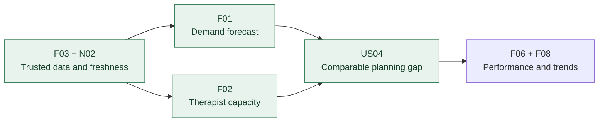

# 03 — Requirements Analysis & Prioritisation

**Pinnacle Wellness Resort | Independent Business Analysis Portfolio Case Study | 2026**

*Fictional scenario · Proposed requirements for analysis, not stakeholder-approved scope or delivered functionality.*

**Previous:** [02 — Strategy & Solution Evaluation](02-strategy-and-solution-evaluation.md) · **Next:** 04 — Business Process & Solution Modelling *(planned)*

## 1. Requirements Scope & Business Alignment

Stage 2 prioritised **treatment-demand and therapist-capacity forecasting** to support operational planning (**BO2**). This requires trustworthy booking and capacity data (**BO1 dependency**), but it does not solve real-time reservations or personalised guest-service workflows (**BO2/BO3 gaps**).

**Requirements decision:** Develop a detailed baseline for **Demand & Capacity Decision Support**; assess the **Wellness Companion App** only as a separate, exploratory concept for unresolved guest interactions. Neither is an approved implementation, and integration between them is **out of scope**.

| Scope | Business decision / user value | Boundary |
|---|---|---|
| **Primary — operational planning** | Enable managers to anticipate treatment demand and compare it with therapist capacity. | Forecasts, available service hours, reliable inputs and planning comparisons; **no live booking or automatic rostering**. |
| **Exploratory — guest journey** | Let guests provide relevant information, request recommendations and respond to proposed schedules. | Profile, recommendation and schedule states; reservation confirmation and specialist approval are **unresolved scope/policy decisions**. |

**Evidence convention:** **[S]** documented in the existing case analysis/models; **[I]** inferred and requiring validation; **[E]** independent portfolio enhancement. Source support does not imply stakeholder sign-off. All priorities are proposed.

## 2. Stakeholder Needs & House of Quality Insights

Requirements were derived from the decisions stakeholders need to make, rather than starting with technology features.

| Stakeholder need | Business objective | Requirements response / implication |
|---|---|---|
| **Operations Manager:** anticipate bookings and treatment hours | **BO2** | **F01 + F03:** define forecast period, treatment type and usable booking history. |
| **Operations Manager:** recognise capacity constraints | **BO2** | **F02 + F03:** compare available therapist service hours with demand on compatible periods and units. |
| **Operations / data support:** trust planning inputs | **BO1 enabler / BO2** | **F03 + N02:** expose missing or stale source records before decisions are made. |
| **Guests / wellness professionals:** obtain appropriate proposed schedules | **BO1 / BO3** | **W01–W04:** check profile completeness, handle recommendation failures and distinguish schedule outcomes; professional approval policy remains open. |

The forecasting **House of Quality (HoQ)** connects operational stakeholder needs to system requirements. Its most consequential insight is that **F03 (booking and availability data)** underpins both **F01 (forecast demand)** and **F02 (capacity visibility)**. **F06/F08** support subsequent learning and trends.

These are qualitative relationships, **not invented HoQ weights or verified priorities**. The forecasting HoQ does not prioritise guest-app functionality.

## 3. Prioritised Requirements Backlog

The table is the main navigation point: **Theme → Epic → User Story → Requirement → proposed priority**.

Themes group business outcomes; epics group capabilities. User stories express the stakeholder decision or benefit, not a technical solution commitment.

### Primary workstream — operational planning

| Theme | Epic | User story / business outcome | Requirement | MoSCoW |
|---|---|---|---|---|
| **T1 — Predictive Demand & Capacity Planning** | **E1 — Demand Forecasting** | **US01:** As an Operations Manager, I want bookings and service-hour forecasts by treatment and period so I can anticipate resource demand. | F01, F03 | **Must** |
| T1 | E1 | **US02:** Identify predicted peak and quieter periods to inform staffing discussions. | F01, F08 | Should |
| T1 | **E2 — Therapist Capacity Planning** | **US03:** View available therapist hours by specialisation and period before making capacity decisions. | F02, F03 | **Must** |
| T1 | E2 | **US04:** Compare forecast treatment hours with comparable available therapist hours to identify potential planning gaps. | F01–F03 | **Must** |
| **T2 — Operational Decision Support & Reliable Delivery** | **E3 — Decision Support & Data Reliability** | **US05:** Receive an alert when a defined planning variance needs attention. | F04 | Could |
| T2 | E3 | **US07:** Review assigned therapist appointments and hours; needs a separate detailed schedule source, not just aggregate reports. **[I]** | F05 (partial) | Could / scope gate |
| T2 | E3 | **US08:** As a data-support user, see stale or failed data refreshes before reports are relied upon. | F03, N02 | **Must control** |

**Scope correction:** The earlier **US06 — live appointment availability** belongs to a **transactional booking decision**, not the forecasting backlog. It is not a second forecast feature. The single proposed booking requirement is **W05 / US12** below, and remains outside the primary scope.

### Supporting workstream — exploratory guest journey

| Theme | Epic | User story / business outcome | Requirement | Status |
|---|---|---|---|---|
| **T3 — Personalised Guest Journey** | **E4 — Guest Profile & Schedule** | **US09:** Provide missing wellness-profile details so a schedule can be requested. | W01 | Exploratory [S] |
| T3 | E4 | **US10:** Request recommendations and receive an explicit failure outcome if generation fails. | W02, W04 | Exploratory [S] |
| T3 | E4 | **US11:** Respond to a proposed schedule without implying a treatment reservation exists. | W03 | Exploratory [S/E] |
| T3 | **E5 — Booking Assurance & Specialist Oversight** | **US12:** Confirm a real reservation only after checking qualified therapist and slot availability. | W05 | Scope gate [E] |
| T3 | E5 | **US13:** Have an authorised professional review specified recommendations before release, where policy requires it. | W06 | Policy gate [E] |

### Requirements decisions and minimum usable capability

| Priority | Requirement IDs | Decision rationale |
|---|---|---|
| **Must — operational baseline** | **F03** trusted booking/capacity inputs; **F01** forecast bookings and hours; **F02** available therapist hours; **N02** visible data quality | Without comparable, reliable inputs, forecasting cannot meaningfully support BO2. **US04** combines the core outputs in a read-only planning comparison. |
| **Should** | **F06** forecast-versus-actual variance; **F08** demand trends | Improves ongoing interpretation once the core data and planning view are credible. |
| **Could** | **F04** capacity alerts; **F05** utilisation reports; **F07** read-only allocation scenarios | Useful enhancements but not required to establish the initial planning decision. |
| **Won't Have — primary scope** | Live appointment reservation, automated therapist rostering, guest-app integration | These require different transactional controls, data or solution approvals. |

**Key non-functional controls:**

- **N01:** Authorised role-based access.
- **N02:** Data completeness and freshness visibility.
- **N03:** Privacy and consent for identifiable wellness data.
- **N04:** Understandable forecast definitions and units.
- **N05:** Appropriate state and audit history where applicable.

Specific thresholds, access matrices and retention rules remain **TBD**; no numerical service target is claimed as approved.

### Dependency view — why sequence matters

*This is a logical dependency, not an approved delivery schedule. Forecast hours are **not** live bookable appointments.*

## 4. Testable Outcomes & Critical Business Rules

**INVEST refinement — one meaningful example.**

Original US03 left “capacity” and “period” too open and risked including automatic allocation.

The refined story specifies a **read-only view of available service hours by specialisation for a selected, bounded period**.

This is smaller and more testable; its data dependency (F03) is explicit. Period definition and available-hour calculation still need confirmation before estimation.

Numeric INVEST scores are not treated as delivery approval or business-value evidence.

### Representative acceptance criteria

| ID / story | Given / When | Then — observable result |
|---|---|---|
| **AC01 / US01** | **Given** usable booking history and treatment durations; **when** an authorised manager requests a treatment-period forecast | Display forecast booking count, service hours, period, units and source refresh status. |
| **AC02 / US01** | **Given** required inputs are missing, invalid or stale; **when** a forecast is requested | Identify unreliable inputs; do not present an unqualified current forecast. |
| **AC03 / US03** | **Given** therapist availability records; **when** a manager selects specialisation and period | Show source-matched available service hours and freshness information, without allocating staff automatically. |
| **AC04 / US04** | **Given** compatible treatment/specialisation, time window and hour definitions; **when** demand and capacity are compared | Show forecast hours, available hours and planning variance; do not claim a live booking conflict. |
| **AC05 / US08** | **Given** source refresh failure; **when** data status is opened | Show affected source, last successful refresh and outputs at risk. |
| **AC06 / US09–US11** | **Given** incomplete profile data or unavailable recommendation service; **when** a guest requests a schedule | Request missing details or report failure; never record a false schedule confirmation. |
| **AC07 / US11** | **Given** a proposed schedule exists; **when** the guest accepts it or the response window expires | Record *guest-confirmed* or *expired/unconfirmed* schedule status; do not create a treatment reservation. |
| **AC08 / US12** | **Given** real booking enters approved scope; **when** a reservation is requested | Label it *booked* only after a successful live availability and reservation check; otherwise show *unconfirmed/unavailable*. **[E]** |

**Candidate business rules:**

- **BR01:** Compare demand/capacity only in compatible units and periods.
- **BR02:** A forecast does not establish live slot availability.
- **BR03:** Accepting a *proposed wellness schedule* is not confirming a *treatment booking*.
- **BR04:** Incomplete profiles or failed recommendations must not produce confirmed schedules.
- **BR05:** Recommendations needing professional approval remain pending.
- **BR06:** Protected data must only be visible to authorised users.

*Acceptance criteria and rules are proposed specifications, not executed tests. Booking availability checks and specialist-review logic are independent portfolio enhancements requiring scope/policy validation.*

## 5. Traceability & Remaining Business Gaps

| Business objective → stakeholder decision | Epic / story → requirements → acceptance | Expected contribution / unresolved issue |
|---|---|---|
| **BO2 — plan treatment demand** | **E1 / US01 → F01, F03 → AC01–02** | A qualified forecast could inform planning; forecast accuracy is unvalidated. |
| **BO2 — understand specialist capacity** | **E2 / US03–04 → F01–F03 → AC03–04** | Comparable service hours could expose planning gaps; not real-time booking availability. |
| **BO1 dependency / BO2 — trust source information** | **E3 / US08 → F03, N02 → AC05** | Identify unreliable operational data before decisions; no integrated guest-information solution selected. |
| **BO1 / BO3 — personalised guest interaction** | **E4 / US09–11 → W01–W04 → AC06** | Profile-aware proposed schedules remain exploratory; guest acceptance does not reserve treatment. |
| **BO2 / BO3 — safe release and confirmation** | **E5 / US12–13 → W05–W06 → AC08 + policy TBD** | Reservation and professional-review safeguards require explicit scope and governance decisions. |

**Coverage assessment:**

BO2 is addressed primarily as **planning**, not transactional booking.

BO1 remains an enabling data-quality and access concern, **not a solved continuity programme**.

BO3 depends on the unapproved guest-app/personalisation direction.

No business benefit is claimed as realised.

## 6. Stage 4 — Modelling Handover

| Modelling priority | Model and purpose | Open decision before treating it as agreed design |
|---|---|---|
| **First: Forecast data-to-decision workflow** | **BPMN + use case specification** for input validation, demand forecast, capacity view and management comparison (F01–F03, US01/03/04/08). | Data availability, calculation definitions, planning horizon and freshness tolerance. |
| **Separate: Personalised schedule interaction** | **Use case, sequence and domain class models** for guest profiles, recommendation responses, proposed schedule states and exceptions (W01–W04). | Which guest interactions are in scope; what constitutes a confirmed *schedule*. |
| **Conditional: Booking and specialist controls** | **Proposed To-Be BPMN / business-rule scenarios** only if W05/W06 are accepted for exploration. | Actual reservation system, qualified therapist check, approval categories and ownership. |

**Stage 3 outcome:** A **working, traceable requirements baseline** for modelling.

The next decisions are **data readiness, booking scope and specialist-review policy**; there is no stakeholder sign-off, integrated deployment or demonstrated value realisation.
