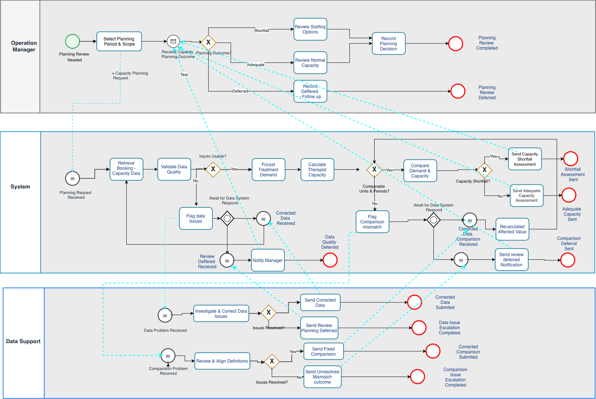
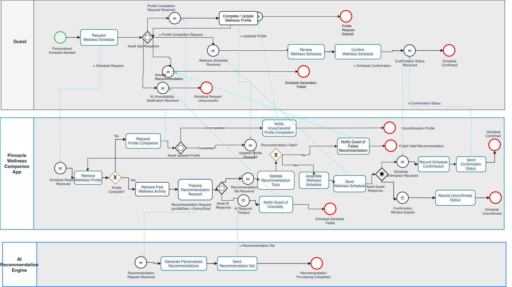
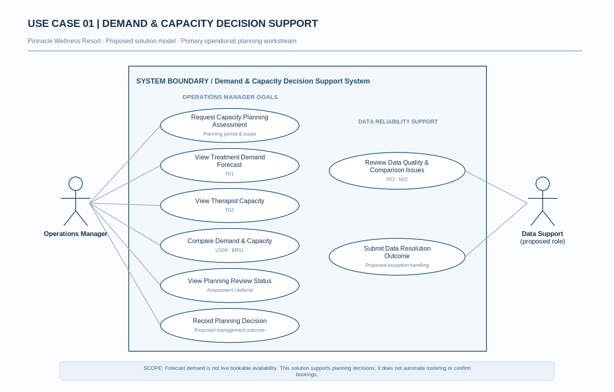
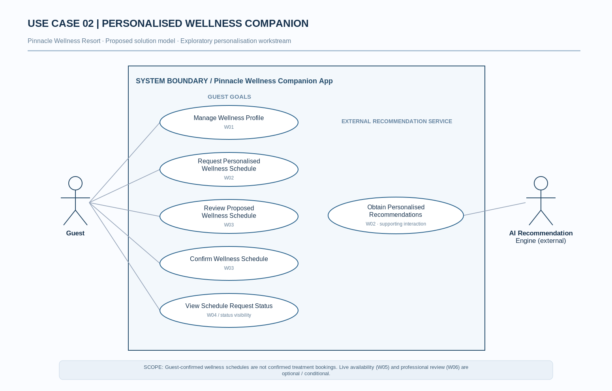
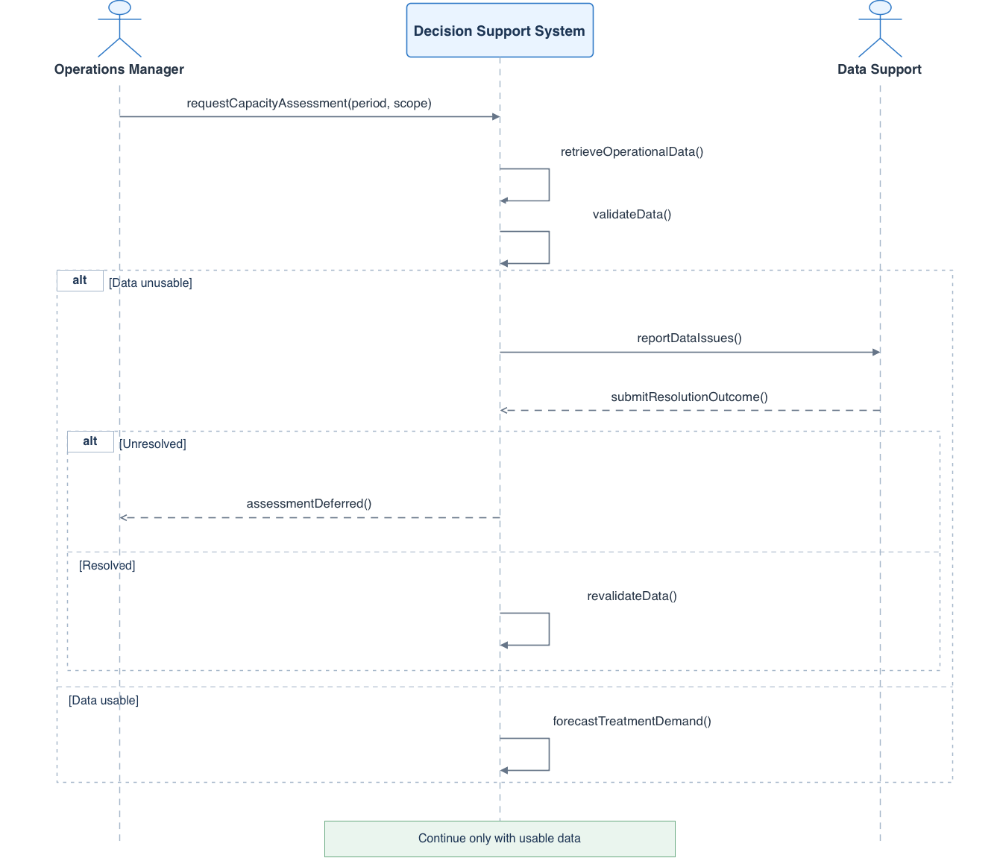
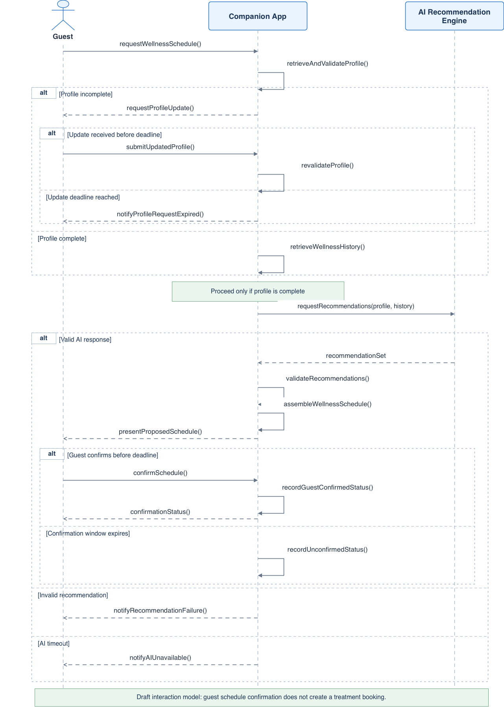
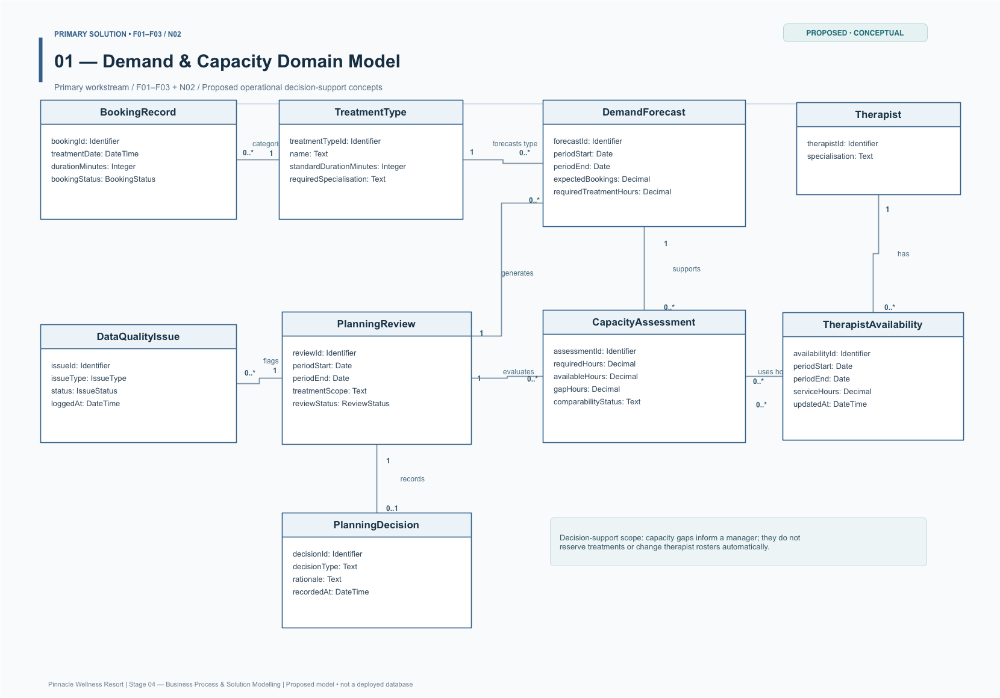
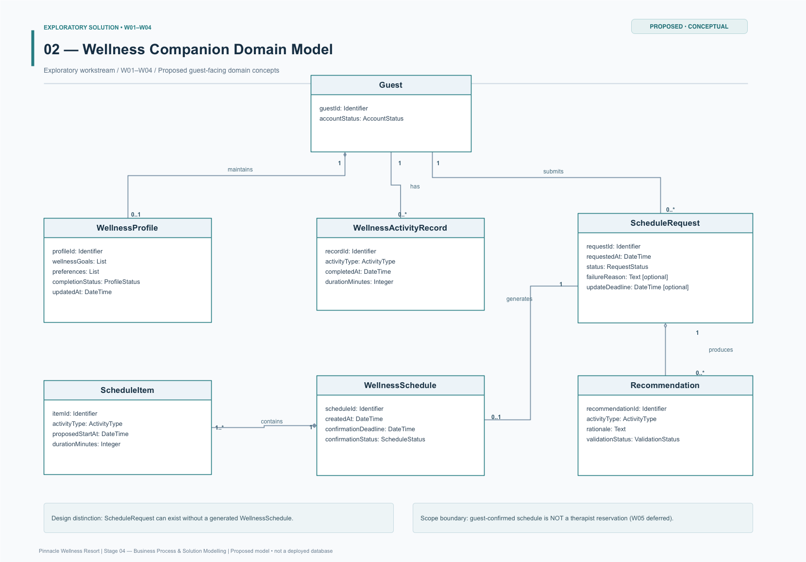

# 04 — Business Process & Solution Modelling

**Pinnacle Wellness Resort | Independent Business Analysis Portfolio Case Study | 2026**  
*Fictional business scenario. All process, system and data models are proposed analytical designs—not verified current-state workflows, approved delivery scope or implemented software.*  
**Previous:** [03 — Requirements Analysis & Prioritisation](03-requirements-analysis-and-prioritisation.md) · **Next:** 05 — Proposed Validation & Business Value *(planned)*

## Purpose and design decision

Stage 3 established a prioritised requirements baseline. This stage translates that baseline into **business decisions, system responsibilities, information relationships and exception-handling behaviour**. The central question is not whether Pinnacle could build more technology, but whether proposed functionality would support dependable service decisions without obscuring its limitations.

Two related **but independent** workstreams are modelled:

- **Primary — Demand & Capacity Decision Support (BO2):** qualify operational data, forecast treatment demand, assess available therapist hours and enable a manager to document a planning response. This is **not** automatic rostering or live appointment availability.
- **Exploratory — Wellness Companion App (BO1/BO3):** let a guest supply wellness information, request AI-assisted recommendations, review a proposed schedule and record a response. This is **not** a confirmed treatment reservation or an approved personalisation rollout.

These models investigate distinct aspects of Pinnacle's information-continuity and service-coordination problem. **No integration between the workstreams is designed or claimed.**

## 1. Modelling Scope & Approach

The business scenario describes fragmented guest information, specialist-dependent appointments and difficult coordination of treatment demand with capacity. It does not provide sufficiently observed hand-offs, timings or staff behaviours to justify a detailed **As-Is BPMN**. Instead, the current-state evidence informs **proposed To-Be** workflows and explicit design assumptions.

| Model | Question answered | Analytical contribution |
|---|---|---|
| **BPMN — 2 processes** | How would participants act, decide and handle exceptions? | Makes ownership, hand-offs, data controls and completion/defer outcomes visible. |
| **Use Case — 2 boundaries** | Who needs which system capability? | Separates actor goals from background calculations and excludes unsupported features. |
| **Sequence — 2 interaction views** | What messages cross participant boundaries, in what scenario? | Exposes dependencies, responses, conditional paths and potentially misleading state transitions. |
| **Domain Class — 2 conceptual models** | What information must be distinguishable and related? | Checks data meaning, multiplicities and integrity constraints before any physical schema is proposed. |

The diagrams are linked by Stage 3 business objectives, user stories, acceptance criteria and rules. A model's presence **does not** establish technical feasibility, stakeholder agreement or measured benefit. In particular, the forecasting workstream's *Must* requirements are distinct from the companion app's *exploratory* requirements.

## 2. Proposed Business Process Models

### 2.1 Demand & Capacity Planning — To-Be BPMN

[View full-size planning BPMN](diagrams/01-demand-capacity-to-be-bpmn.png)

**Trigger and accountability.** An **Operations Manager** initiates a planning review and specifies a period and treatment scope. The **Decision Support System** obtains historical booking and therapist-capacity data; **Data Support** is a proposed exception-handling participant, not a confirmed existing team assignment. The intended outcome is either a **recorded management decision** or a **documented deferral**.

The proposed workflow gives reliability precedence over producing a forecast. After retrieval, the system checks input quality. An unusable-data result prompts an investigation: corrected records return to retrieval and validation; an unresolved issue is communicated as a deferred review. With usable inputs, the system forecasts treatment demand, calculates available therapist service hours and checks whether the outputs are comparable by **period, unit and relevant treatment/specialisation**. A mismatch is sent for clarification and corrected values are recalculated before rechecking. If no reliable comparison is possible, the assessment is deferred rather than presented as authoritative.

Only comparable results proceed to a **potential capacity-shortfall** decision. Where forecast required hours exceed available hours, the manager reviews staffing or service-planning options; otherwise, the manager reviews normal capacity. Either route ends with a recorded planning decision, **not** an automatic change to the therapist roster. A shortfall is a *planning signal*, not evidence of an actual double-booking or an unavailable appointment.

**Business rationale.** F03 and N02 are dependencies, not merely support features: unqualified historical inputs could create a persuasive but misleading staffing recommendation. F01 and F02 provide different quantities; **US04 / BR01 / AC04** justify their comparison only when definitions align. The process also preserves human accountability for the response to a forecast.

### 2.2 Personalised Wellness Scheduling — To-Be BPMN

[View full-size wellness scheduling BPMN](diagrams/02-personalised-wellness-to-be-bpmn.png)

**Trigger and participants.** A **Guest** requests a personalised wellness schedule. The **Wellness Companion App** manages profile checks, recommendation validation and schedule status; an **external AI Recommendation Engine** supplies candidate recommendations. This is a separately scoped concept, not an extension of the forecasting system.

The app retrieves the guest's wellness profile. If required information is missing, it requests a profile update rather than proceeding with an incomplete personalisation input. The model includes an unsuccessful-completion notification and a guest-side expiry outcome, although the precise expiry trigger and waiting-event notation require refinement (see Section 7). A profile that is complete can support retrieval of relevant activity history and preparation of a recommendation request.

The app then awaits an AI response. **Timeout** and **received-but-invalid recommendation data** are distinct exceptions; neither should produce a confirmed schedule. On a usable response, the app validates the recommendations, assembles a **proposed** wellness schedule and presents it to the guest. Guest confirmation is recorded as a **guest-confirmed schedule state**. If the response window expires, the schedule remains **unconfirmed**. These statuses concern the guest's proposed wellness plan, **not** the booking of a therapist or treatment slot.

**Business rationale.** The process makes the controls in **W01–W04, BR03–BR04 and AC06–AC07** visible: completeness is checked before recommendation generation, AI failure is reported rather than concealed, and a guest's silence must not be misinterpreted as confirmation. A future real booking flow (**W05**) would need its own live availability and reservation rules. Professional approval (**W06**) remains a policy-dependent decision, not an automatically operating workflow.

### 2.3 Cross-process design choices

The models share an **exception-first principle** without implying shared software: unreliable demand/capacity data stops an unqualified planning assessment; incomplete guest information or unusable recommendations stops an unsupported wellness outcome. Both also distinguish **system-generated information** from a **human decision**. In the primary process that decision belongs to Operations Management; in the exploratory process it is the guest's response to a proposed schedule, subject to any future professional-review policy.

## 3. System Scope & Use Case Analysis

### 3.1 Primary system — Demand & Capacity Decision Support

[View full-size planning use cases](diagrams/03-demand-capacity-use-case.png)

The **Operations Manager** can request an assessment, view demand and therapist-capacity outputs, compare them, check review status and record a decision. The proposed **Data Support** actor reviews data-quality or comparability issues and submits a resolution outcome. The boundary represents capabilities visible to those actors—not each internal algorithm, validation function or BPMN step. Consequently, the manager's goal is **to make a qualified capacity decision**, rather than merely to execute a forecast calculation.

### 3.2 Exploratory system — Wellness Companion App

[View full-size Companion App use cases](diagrams/04-wellness-companion-use-case.png)

The **Guest** manages a wellness profile, requests a personalised schedule, reviews and confirms a proposed schedule, and checks request status. The **external AI Recommendation Engine** supports the app's *Obtain Personalised Recommendations* interaction. Placing it outside the app's boundary exposes an external dependency; it does not imply direct Guest–AI communication. The focused view excludes meal ordering, payments and loyalty functions from the earlier broad app concept, and does not silently add treatment booking or professional approval.

### 3.3 Selected use case specifications

**UC-01 — Compare Demand & Capacity**

| Field | Proposed specification |
|---|---|
| **Primary actor / goal** | Operations Manager — identify potential therapist-capacity gaps for a specified period and treatment scope (**US04**). |
| **Preconditions** | Authorised access; usable booking history and availability data; forecast and capacity outputs defined on comparable periods, service-hour units and specialisations. |
| **Main success scenario** | Request planning view → retrieve qualified forecast and available hours → compare values → show variance and source status → manager reviews options and records a planning decision. |
| **Alternatives** | Missing/stale inputs (**AC02/AC05**) or incompatible comparison definitions (**BR01**) → request correction; if unresolved, record a deferred review rather than an unqualified comparison. |
| **Postcondition** | Qualified planning comparison and documented decision, **or** transparent deferral. No therapist roster or treatment reservation changes automatically. |

**UC-02 — Request Personalised Wellness Schedule**

| Field | Proposed specification |
|---|---|
| **Primary actor / goal** | Guest — obtain a proposed wellness plan informed by eligible profile information and activity history (**US09–US11**). |
| **Preconditions** | A schedule request can be identified; the app can evaluate the required wellness-profile fields and permitted data use. |
| **Main success scenario** | Guest requests schedule → app checks and, where needed, requests profile details → app obtains and validates recommendations → presents proposed schedule → guest responds → app records and communicates status. |
| **Alternatives** | Missing profile information, expiry, AI timeout, invalid recommendation or unanswered confirmation → show failure/expiry/unconfirmed status; never record a false confirmation (**AC06–AC07**). |
| **Postcondition** | A valid proposed schedule with an appropriate response status, or a failed/expired request with **no falsely confirmed schedule**. No treatment booking is implied. |

These are **analysis specifications**, not executed user journeys or completed UAT scenarios. Internal data checks and AI calls are elaborated in the process and sequence models instead of being inflated into numerous separate use cases.

## 4. Sequence & Interaction Modelling

### 4.1 Demand & Capacity — focused interaction excerpt

[View full-size planning sequence](diagrams/05-demand-capacity-sequence.png)

This **focused excerpt** follows an Operations Manager's assessment request through operational-data retrieval, validation and interaction with Data Support. Its `alt` fragments distinguish an unusable input and a resolved versus unresolved correction outcome; the latter sends a deferral message. It establishes which participant communicates the issue and who returns a correction result.

**Coverage boundary:** The image stops around the transition to forecasting. It **does not depict** the complete capacity calculation, comparability rework, shortfall assessment or final management decision shown in the BPMN. The resolved-data path's return to normal forecasting is also not fully explicit in this sequence excerpt. Those interactions should be expanded if this becomes an implementation-ready specification; the BPMN remains the fuller process view.

### 4.2 Wellness Companion — guest and external AI exchange

[View full-size Companion App sequence](diagrams/06-wellness-companion-sequence.png)

The sequence separates Guest, Companion App and AI lifelines. `alt` fragments show profile-update outcomes, AI recommendation outcomes and guest-confirmation outcomes. The app controls profile and recommendation validation, while the external AI service supplies candidate recommendation data. The schedule is assembled **after** a usable recommendation result; guest confirmation then changes the schedule's response status, not any treatment booking state.

**Coverage boundary:** The image does **not** contain an explicit UML `loop` for repeated profile updates, nor does its text alone enforce an early stop after every failure branch. Its high-level alternatives communicate intended behaviour, but explicit **revalidation/termination guards**, the ordering of response receipt versus validation, and the profile deadline should be refined before technical implementation. No automatic AI retry or specialist approval sequence is claimed.

## 5. Domain Class Modelling

### 5.1 Demand & Capacity — operational decision information

[View full-size operational domain model](diagrams/07-demand-capacity-domain-model.png)

Nine conceptual classes separate **operational evidence** (`BookingRecord`, `TreatmentType`, `Therapist`, `TherapistAvailability`) from **derived assessments** (`DemandForecast`, `CapacityAssessment`) and **review governance** (`PlanningReview`, `DataQualityIssue`, `PlanningDecision`). This matters because a forecast is not an appointment, and a capacity assessment is not a staff allocation instruction.

The diagram associates booking records with treatment types, forecasts with treatment scope, therapists with availability records, and a planning review with its analyses, issues and potential recorded decision. Its proposed multiplicities allow historical records, many availability entries and multiple analytical outputs, while a review may have **no recorded decision yet**. Available-hour definitions, booking-status treatment and issue ownership remain conceptual assumptions. A physical data model would additionally require source lineage, calculation grain and uniqueness rules.

### 5.2 Wellness Companion — request, recommendation and schedule states

[View full-size Companion App domain model](diagrams/08-wellness-companion-domain-model.png)

The seven classes distinguish a **person and their information** (`Guest`, `WellnessProfile`, `WellnessActivityRecord`), a **request lifecycle** (`ScheduleRequest`), **generated candidate content** (`Recommendation`) and a **proposed output** (`WellnessSchedule`, `ScheduleItem`). A Guest may hold multiple historical activity records and submit multiple schedule requests. The model proposes **zero or one current profile per guest**, and each request may generate **zero or one wellness schedule**, with multiple recommendations but potentially none after failure.

**The consequential distinction is `ScheduleRequest` versus `WellnessSchedule`.** A profile-update timeout or AI failure can leave a request without any generated schedule; a generated schedule can exist but remain unconfirmed; and a guest-confirmed schedule still does **not** create a `TreatmentBooking`. `ScheduleItem` composition represents proposed activities belonging to a schedule, not allocated therapist slots. The illustrated cardinalities, statuses and date fields are **design hypotheses**, not a verified existing database schema.

## 6. Cross-model Consistency & Requirements Traceability

The test of model quality is whether the same decision, state and control mean the same thing across representations. The table below connects the modelling evidence to the working requirements baseline in [Stage 3](03-requirements-analysis-and-prioritisation.md).

| Objective and user need | Requirements / test reference | BPMN & Use Case | Sequence / Domain support | Intended decision or control |
|---|---|---|---|---|
| **BO2 — anticipate demand** | **US01; F01/F03; AC01–02** | Planning BPMN; **View Demand Forecast** | Planning sequence retrieval/forecast excerpt; `BookingRecord`, `TreatmentType`, `DemandForecast` | Forecast bookings and required hours only when source data is qualified. |
| **BO2 — assess specialist capacity** | **US03–04; F02/F03; AC03–04; BR01–02** | Planning BPMN; **View Therapist Capacity**, **Compare Demand & Capacity** | `TherapistAvailability`, `CapacityAssessment`, `PlanningReview` | Match periods, units and specialisation; distinguish a shortfall signal from live availability. |
| **BO1 enabler / BO2 — trust inputs** | **US08; F03/N02; AC02/05** | Data-correction and deferral branches; **Review Data Quality & Comparison Issues** | Data Support sequence; `DataQualityIssue` | Visible source defects and documented deferral instead of silently misleading results. |
| **BO1 / BO3 — profile-aware experience** | **US09–10; W01/W02/W04; AC06; BR04** | Companion BPMN; **Manage Wellness Profile**, **Request Wellness Schedule** | Guest/App/AI sequence; `WellnessProfile`, `ScheduleRequest`, `Recommendation` | Prevent schedule generation from proceeding on unresolved profile or AI failure. |
| **BO3 — trustworthy guest response** | **US11; W03/W04; AC07; BR03** | Schedule response/expiry branches; **Review**, **Confirm**, **View Status** | Confirmation sequence; `WellnessSchedule`, `ScheduleItem` | Keep guest-confirmed, unconfirmed and failed outcomes distinct from a real treatment reservation. |
| **BO1 / BO3 — future safeguards** | **US12–13; W05/W06; AC08; BR05–06** | **Outside current baseline**; policy/scope gates only | No live booking or specialist approval domain/interaction is claimed | Validate booking evidence, authorised data use and professional oversight before extending scope. |

**What the models establish:** two proposed boundaries, explicit exception outcomes, candidate data constraints and decisions attributable to people. **What they do not establish:** a shared application, implemented data integration, booking capability, tested forecast accuracy or an approved professional-review workflow.

## 7. Design Limitations, Assumptions & Open Decisions

**Evidence versus inference.** Fragmented guest information and specialist scheduling complexity come from the fictional scenario. Data Support's direct system interface, specific correction workflows, forecast outputs, class cardinalities and app state handling are **retrospective portfolio design proposals**. They need business and technical validation; they are not observations of existing staff or systems.

- **Data readiness and calculation semantics:** Confirm booking-status exclusions, historical coverage, treatment durations, therapist specialisation, effective availability, matching time windows, refresh tolerance and forecast-performance criteria. A calculated hour gap is not evidence of live appointment feasibility (**F03/N02/N04; BR01–02**).
- **Data correction ownership and access:** Define who can alter source records, who may approve corrected figures and how unresolved issues are logged. Validate access permissions and audit history (**N01/N05**). No correction SLA or number of permitted retries has been established.
- **Guest information and AI suitability:** Determine permitted wellness-profile fields, consent, access controls, personal-data retention, recommendation-quality checks, failure communication and third-party processing safeguards (**N03, BR06**). The diagrams do not establish regulatory compliance.
- **Deadlines and professional controls:** Specify profile-update and schedule-confirmation timeouts, what happens after late responses, and whether selected AI recommendations require specialist review (**W06/BR05**). In the wellness BPMN, the *Await Updated Profile* branch is not yet expressed as a fully explicit event-based **message-versus-timer** race; the guest-side expiry handling and repeated-update semantics remain a notation review item.
- **Transaction boundary:** Keep *forecast demand*, *available therapist hours*, *proposed wellness schedule*, *guest-confirmed schedule* and *confirmed treatment booking* separate. Actual slot checks, qualified-therapist assignment and booking confirmation require a distinct approved flow (**W05/AC08**).

**Model QA finding:** These diagrams are suitable as **conceptual portfolio artefacts**, but the sequence excerpts and the unresolved profile-wait notation should not be represented as verified, executable end-to-end specifications. Their limitations are recorded rather than concealed.

## 8. Stage 4 Outcomes & Transition to Stage 5

Stage 4 produces a **traceable proposed modelling package**: two To-Be BPMNs, two focused use-case boundaries, two sequence interaction views and two conceptual domain class models. Their collective value is to make the requirements **inspectable**: stakeholders could challenge whether a forecast is comparable, whether a response state is valid, and who owns failure resolution **before** any delivery commitment.

The next stage, **05 — Proposed Validation & Business Value** *(planned)*, should translate these models into a validation plan:

| Proposed Stage 5 check | Evidence to seek—not a claimed completed result |
|---|---|
| **Operational data controls** | Controlled missing, stale and mismatched-source scenarios; correct qualification or deferral of outputs (AC02/05). |
| **Planning decision usability** | Walkthroughs comparing forecast hours and matched capacity hours; correct interpretation of a planning gap (AC01/03/04). |
| **Guest interaction outcomes** | Scenario-based checks for incomplete profiles, late updates, AI timeout, invalid recommendations, guest confirmation and expiry (AC06/07). |
| **Governance and scope gates** | Review consent/access assumptions, conditional specialist oversight and any future live reservation rules (N01/N03, W05/W06). |
| **Business-value measures** | Agree starting baselines and measurement methods for BO1 information continuity, BO2 scheduling/capacity coordination and BO3 guest experience. |

**Outcome:** A defensible analysis-to-design narrative—not a claim of stakeholder sign-off, completed UAT, deployment or realised improvement. The next decision is **what must be validated before either proposed solution could responsibly proceed**.
