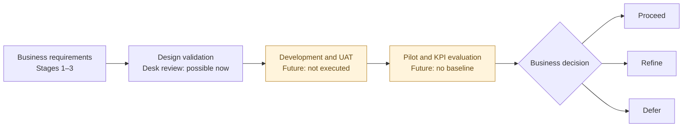

# 05 — Proposed Validation & Business Value Evaluation

**Pinnacle Wellness Resort · Independent Business Analysis Portfolio · 2026**  
**Previous:** [04 — Business Process & Solution Modelling](04-business-process-and-solution-modelling.md) · **Project:** [Repository overview](README.md)

> **Evidence boundary:** Fictional case study; proposed BA artefacts only. **Neither solution has been developed. No real Pinnacle dataset, executed UAT, pilot, stakeholder sign-off or measured business benefit is claimed.** All tests and decision gates below are proposed.

**Navigate:** [01 Overview](#01-stage-overview) · [02 Design validation](#02-requirements-and-design-validation) · [03 UAT plan](#03-proposed-uat-strategy) · [04 Readiness](#04-data-ai-and-operational-readiness) · [05 Business KPIs](#05-business-value-and-kpi-framework) · [06 Decision gates](#06-pilot-evaluation-and-decision-gates) · [07 Evidence gaps](#07-risks-assumptions-and-evidence-gaps) · [08 Recommendations](#08-final-ba-recommendations)

---

## 01. Stage Overview

**Decision question:** What evidence would Pinnacle need to establish that the proposed solutions meet business needs, can be introduced responsibly and could deliver measurable value?

| Business objective | Proposed workstream | What can be assessed now | What requires future evidence |
|---|---|---|---|
| **BO1 — Improve Guest Information Continuity** | Wellness Companion: authorised profile use; **not** a cross-system information solution | Profile rules and information dependencies | Data permissions, real-user workflows; cross-service continuity remains a wider gap |
| **BO2 — Improve Treatment Scheduling Efficiency** | **A — Demand & Capacity Decision Support** (prioritised) | Requirements, forecast/capacity definitions and BPMN exceptions | Working solution, representative data, UAT and operational baseline/pilot |
| **BO3 — Improve Personalised Guest Experience** | **B — AI-Powered Wellness Companion** (exploratory) | Guest journey, recommendation and schedule-state rules | AI safeguards, guest testing and post-pilot feedback |

**Three distinct questions:** **Design validation** asks whether requirements and models are coherent; **UAT** asks whether a developed solution meets user needs; **benefits evaluation** asks whether its use improves business outcomes. Passing one does not establish the others.

## 02. Requirements and Design Validation

**Method:** Cross-check the [Stage 3 requirements baseline](03-requirements-analysis-and-prioritisation.md) against the [Stage 4 BPMN, Use Case and UML models](04-business-process-and-solution-modelling.md). This is a **desktop traceability review**, not stakeholder validation.

| BO | Requirement / story / acceptance | Model evidence | Validation question | Evidence status |
|---|---|---|---|---|
| BO2 | **F01, US01, AC01–02** | [Planning BPMN](diagrams/01-demand-capacity-to-be-bpmn.png), [sequence](diagrams/05-demand-capacity-sequence.png), `DemandForecast` | Are forecast **booking counts**, **required treatment hours**, period and source status unambiguous? | Modelled; definitions unverified |
| BO2 | **F02, US03, AC03** | [Planning use case](diagrams/03-demand-capacity-use-case.png), `TherapistAvailability` | Are *available* hours derived by period/specialisation rather than inferred from bookings alone? | Modelled; source rules unverified |
| BO2 (BO1 data dependency) | **F03, N02, US08, AC02/05** | Planning BPMN data-correction/deferral path; `DataQualityIssue` | Are missing/stale sources visible, assigned for resolution and prevented from producing unqualified outputs? | Control proposed; owners/thresholds open |
| BO2 | **US04, F01–03, AC04, BR01–02** | [Comparison use case](diagrams/03-demand-capacity-use-case.png), `CapacityAssessment`, `PlanningReview` | Are time windows, units and treatment/specialisation compatible? Is a planning shortfall kept distinct from a live slot conflict? | Modelled; comparison rules open |
| BO1/BO3 | **W01, US09, AC06, BR04** | [Companion BPMN](diagrams/02-personalised-wellness-to-be-bpmn.png), `WellnessProfile` | Is required profile information checked and rechecked before AI submission? | Modelled; mandatory fields open |
| BO1/BO3 | **W02/W04, US10, AC06, BR04** | [Companion sequence](diagrams/06-wellness-companion-sequence.png), `Recommendation` | Is AI service unavailability reported rather than producing a false confirmation? Is invalid output rejected under a proposed additional validation rule? | Modelled; recommendation-validity rules open |
| BO3 | **W03, US11, AC07, BR03** | [Companion use case](diagrams/04-wellness-companion-use-case.png), `WellnessSchedule` | Are guest-confirmed and expired/unconfirmed schedule states distinct from **treatment booked**? | Modelled; timing rules open |

**Design-review findings and open decisions before UAT:**

1. **Acceptance-criteria baseline:** Stage 3 defines **AC06** for incomplete profiles or an unavailable recommendation service; **AC07** for guest confirmation versus expiry of a proposed schedule; and **AC08** for a real reservation, **only if booking enters approved scope**. **AC09 and AC10 are not defined** in the Stage 3 baseline. Invalid AI output handling and conditional specialist-review acceptance need explicit business-rule clarification, not invented AC IDs.
2. **BPMN notation refinement:** The Companion *Await Updated Profile* branch needs a clearer message-versus-timer waiting/expiry representation; confirm how repeated updates and late responses work.
3. **Scope gates:** **W05/US12/AC08** (actual booking) and **W06/US13/BR05** (conditional professional review; acceptance criteria still to be agreed) are **not implemented capabilities**. **N01/N03/BR06** controls require defined access, consent and privacy rules.

## 03. Proposed UAT Strategy

### 03.1 Who would test, when and how?

| Element | Proposed approach |
|---|---|
| **Purpose** | Assess whether a **future implemented release** supports the intended user journeys and business rules—not whether the diagrams look correct. |
| **Business participants** | A: Operations Manager; proposed Data Support participant. B: representative Guest users; authorised wellness specialist **only if W06 applies**. |
| **Entry criteria** | Agreed scope and criteria; testable build; prior QA checks; accessible test environment; agreed representative and privacy-safe test data. |
| **Test execution** | Business users perform realistic tasks, record **actual versus expected** outcomes, and identify defects or requirement ambiguities. |
| **Responsibilities** | BA coordinates scenarios, traceability and clarifications; QA/developers investigate defects; an authorised business owner/product owner determines acceptance. |
| **Defects and retesting** | Log severity, reproduce conditions, assign owner, retest fixes and record unresolved risks. |
| **Exit criteria** | Critical journeys assessed; material defects addressed or explicitly accepted by authorised decision-makers; formal sign-off **not presumed**. |

### 03.2 Workstream A — Demand & Capacity (six proposed scenarios)

| Test | Requirement / rule | Business scenario | Expected outcome | Status |
|---|---|---|---|---|
| **UAT-A01** | F01/F03 · US01 · AC01 | Request forecast from usable booking history | Booking counts, required hours, period, units and refresh status visible | Not executed |
| **UAT-A02** | F03/N02 · AC02/05 | Source records missing or stale | Affected input flagged; no unqualified current forecast | Not executed |
| **UAT-A03** | F02/F03 · US03 · AC03 | View therapist availability for chosen specialisation/period | Source-matched available service hours; no automatic allocation | Not executed |
| **UAT-A04** | US04 · AC04 · BR01 | Compare different periods/units/specialisations | Misleading comparison blocked pending clarification | Not executed |
| **UAT-A05** | US04 · AC04 · BR01–02 | Forecast required hours exceed comparable capacity | Potential planning shortfall shown; no roster or booking changed | Not executed |
| **UAT-A06** | F03/N02 · AC02/05 | Data issue remains unresolved after review | Assessment deferred with reason/status visible (**proposed refinement**) | Not executed |

### 03.3 Workstream B — Wellness Companion (six proposed scenarios)

| Test | Requirement / rule | Business scenario | Expected outcome | Status |
|---|---|---|---|---|
| **UAT-B01** | W01 · US09 · AC06 · BR04 | Guest submits incomplete wellness profile | Missing required fields requested; AI submission withheld | Not executed |
| **UAT-B02** | W01 · AC06 | Guest completes requested profile details | Completeness rechecked before continuing (**proposed path**) | Not executed |
| **UAT-B03** | W02/W04 · US10 · AC06 · BR04 | External AI service times out | Failure/unavailable status; no confirmed schedule | Not executed |
| **UAT-B04** | W02/W04 · US10 · BR04 (**proposed validation refinement**) | AI returns invalid recommendation content | Output rejected; no unsupported proposed schedule/confirmation | Not executed |
| **UAT-B05** | W03 · US11 · AC07 · BR03 | Guest confirms a valid **proposed schedule** within the window | Guest-confirmed schedule state; **no treatment booking** | Not executed |
| **UAT-B06** | W03 · US11 · AC07 · BR03 | Guest does not respond before deadline | Expired/unconfirmed status; no false confirmation | Not executed |

### 03.4 Two detailed future test scripts

<strong>UAT-A05 — Identify a potential capacity shortfall</strong>

| Field | Proposed test specification |
|---|---|
| **Preconditions** | A future test build is available; demand and capacity values share period, units and specialisation; source status is qualified. |
| **Illustrative test inputs** | Required treatment hours: **120**; available therapist service hours: **95** for the same selected scope. **Not resort data.** |
| **User steps** | (1) Operations Manager selects period/scope. (2) Requests assessment. (3) Reviews demand, capacity and variance. |
| **Expected result** | Show a **25-hour potential shortfall** with definitions and source status. Permit a human planning review; do **not** auto-roster staff or claim appointment unavailability. |
| **Evidence to record later** | Screenshot/output, actual calculated variance, relevant defect IDs and business-user acceptance decision. |
| **Execution status** | **Not executed — illustrative arithmetic only.** |

<strong>UAT-B05 — Confirm a proposed wellness schedule (not a booking)</strong>

| Field | Proposed test specification |
|---|---|
| **Preconditions** | A complete permitted profile, valid recommendations, generated proposed schedule and agreed response window. |
| **Illustrative test inputs** | Fictional Guest A, valid proposed activities and a response submitted before a configured deadline. No identifiable guest data. |
| **User steps** | (1) Guest reviews proposed schedule. (2) Selects confirm. (3) Views resulting schedule status. |
| **Expected result** | State changes to **guest-confirmed schedule**; confirmation is auditable under agreed rules. No live slot, therapist assignment or treatment reservation is implied. |
| **Evidence to record later** | Status record, timestamp, actual on-screen message, defect IDs and business-user decision. |
| **Execution status** | **Not executed — no app exists.** |

## 04. Data, AI and Operational Readiness

**Readiness is a gate, not an achieved status.** The following evidence is required before a credible build, UAT or pilot decision.

| Check | Scope | Evidence required | Current status |
|---|---|---|---|
| Booking history quality | A | Coverage, booking-status exclusions, treatments/durations, missingness and refresh ownership | **Evidence required** |
| Therapist capacity | A | Availability source, specialisation, non-service time, period/unit definitions | **Evidence required** |
| Forecast evaluation | A | Agreed horizon, historical holdout, baseline method and acceptable error criteria | **Evidence required** |
| Guest information governance | B | Permitted fields, consent basis, retention and third-party processing assessment | **Evidence required** |
| AI output safeguards | B | Validity rules, invalid/timeout paths, quality review and escalation ownership | **Evidence required** |
| Specialist review (conditional W06) | B | Recommendation categories requiring approval and authorised reviewer workflow | **Scope/policy decision** |
| Schedule and booking boundaries | B | Response expiry rules; separate live availability/reservation flow **only if W05 approved** | **Rules/scope open** |
| Security and audit | Both | Role access matrix, protected-data handling and appropriate traceable status changes (N01/N05) | **Evidence required** |

**Before any pilot:**

- [ ] Confirm data ownership, authorised access and representative test datasets.
- [ ] Resolve open definitions, BPMN notation and any remaining cross-stage traceability questions.
- [ ] Agree business acceptance criteria, participants, priorities and defect severity rules.
- [ ] Establish safe AI/guest-information controls before testing the exploratory app.

## 05. Business Value and KPI Framework

**A correct output is not the same as business improvement.** A capacity gap can be calculated correctly while managers still cannot act on it; an app can generate schedules correctly while guests find them unhelpful.

| Objective | KPI | Proposed method / formula | Baseline needed | Proposed future data source | Interpretation |
|---|---|---|---|---|---|
| **BO1** | Eligible guest-profile completeness | Complete required profiles ÷ eligible guest profiles | Current completeness and agreed required fields | Authorised profile audit | **Partial information-quality indicator**; does **not** prove cross-service continuity |
| **BO2** | Planning review turnaround | Median time from review start to recorded decision | Current manual review duration | Review logs / workflow timestamps | Tests whether planning becomes more efficient |
| **BO2** | Timely detection of capacity gaps | Verified material gaps identified before agreed cut-off ÷ verified material gaps | Present lead time and gap criteria | Planning records + retrospectively verified capacity | Tests whether managers see potential shortages early enough |
| **BO2** | Forecast error (MAE) | Mean absolute difference between predicted and actual treatment hours | Historical actuals; naive forecast benchmark | Booking actuals + model outputs | Tests **analytical accuracy**, not realised business value |
| **BO2** | Scheduling conflict rate | Confirmed booking conflicts ÷ total bookings | Comparable pre-change period and conflict definition | Booking/incident records | **Indirect downstream measure**; changes cannot automatically be attributed to forecasting |
| **BO3** | Valid schedule generation rate | Valid proposed schedules ÷ eligible requests | Existing process reliability, if comparable | Future app request/status logs | Tests system reliability, not guest satisfaction |
| **BO3** | Guest schedule confirmation rate | Guest-confirmed proposed schedules ÷ valid proposals delivered with completed response windows | Current acceptance pattern, if comparable | Future schedule-status logs | Indicates engagement, **not actual reservation** |
| **BO3** | Guest satisfaction with personalisation | Positive responses ÷ valid survey responses (definition TBD) | Pre-change comparable guest feedback | Post-experience survey | Tests perceived usefulness; consider survey-response bias |

**Measurement design:** For each selected KPI, a business owner must agree the definition, reporting period, baseline, feasible target and interpretation. Future assessment should follow **baseline → controlled pilot → comparable follow-up → review of confounding factors → decision**. For a forecast, evaluate on unseen historical periods before relying on it operationally. No baseline, target or improvement percentage is asserted here.

**Coverage limitation:** BO1's wider cross-functional guest-information continuity is **not fully addressed** by either scoped solution; profile completeness is only a partial proxy. Real-time booking conflicts may also depend on workflows beyond Workstream A.

## 06. Pilot Evaluation and Decision Gates

| Gate | Evidence needed to pass | Indicative decision owner | Current position |
|---|---|---|---|
| **1 — Design readiness** | Traceability reviewed; ambiguous requirements, BPMN exceptions and conditional scope resolved | Business owner with BA and relevant users | **Open** |
| **2 — Delivery/data readiness** | Feasible data sources; approved safeguards; deliverable solution and agreed test strategy | Delivery, data and governance leads | **Not assessed** |
| **3 — UAT acceptance** | Working release; completed business journeys; defect disposition and authorised sign-off | Authorised business/product owner | **Not executed** |
| **4 — Pilot benefits review** | Baselines, comparable observations, user feedback, operational risks and forecast accuracy where relevant | Business sponsor/operations | **No pilot evidence** |

**Different pilot questions for different workstreams:**

- **A — Demand & Capacity:** Can managers reliably review forecast hours versus usable therapist capacity, identify gaps early and record planning responses? Compare with the existing process over comparable periods; separate forecasting accuracy from operational decisions.
- **B — Wellness Companion:** Are recommendations appropriate under agreed safeguards? Can guests understand and respond to schedules, and do they find them useful? Review privacy, AI quality and any specialist gate **before** controlled exposure.

| Decision | Proposed rule |
|---|---|
| **Proceed** | Agreed acceptance, safety/readiness and value criteria are supported by sufficient evidence. |
| **Refine** | Correctable issues remain; retest or extend a bounded pilot before wider use. |
| **Defer** | Critical evidence, data quality, governance, feasibility or benefits case is insufficient. |

**Neither workstream has a go-live recommendation or pilot approval at this stage.**

## 07. Risks, Assumptions and Evidence Gaps

| Open issue | Potential business impact | Evidence needed | Proposed next action |
|---|---|---|---|
| No verified operational dataset | Unreliable forecast/capacity assessment | Authorised booking and availability extracts | Conduct source/data-readiness review |
| Unimplemented solutions | Cannot execute UAT | Testable build and configured environment | Retain UAT scripts for future delivery |
| Undefined comparison and freshness rules | Misleading capacity signal | Agreed unit, period, specialisation and refresh criteria | Resolve with operations/data owners |
| Unproven forecast accuracy | Poor staffing decisions | Out-of-time testing and benchmark comparison | Define evaluation before deployment |
| Guest-data and AI safeguards undecided | Privacy or recommendation suitability risk | Consent/access rules, output checks, oversight policy | Undertake governance and specialist review |
| Booking-status ambiguity | Guest may believe a proposed schedule is booked | Separate state definitions and transactional boundary | Keep W05/US12/AC08 behind an explicit scope gate |
| No KPI baselines | Cannot quantify realised benefit | Current operating measures and comparable periods | Instrument baseline collection before pilot |

## 08. Final BA Recommendations

### A — Prioritised operational workstream

**Advance Demand & Capacity Decision Support to data-readiness and detailed feasibility assessment**, subject to clarification of F01–F03, N02 and US04 definitions. Consider development only when the input data and planning decisions can be evaluated credibly; a forecast must not be treated as live appointment availability or an instruction to change rosters automatically.

### B — Exploratory personalisation workstream

**Retain the Wellness Companion as a separate, conditional concept.** Validate the guest journey and permissible information use before any build decision. Recommendation suitability and AI failure handling (**AC06/BR04**), guest-confirmation semantics (**AC07/BR03**), optional professional review (**W06/US13/BR05**; acceptance criteria to be agreed) and live booking (**W05/US12/AC08**, conditional scope) require explicit policy and scope decisions.

### Project completion versus future delivery

- [x] **BA design package prepared:** business problems and BO1–BO3; option assessment; proposed requirements, user stories and acceptance criteria; two To-Be BPMNs and supporting UML; proposed UAT scenarios and KPI framework.
- [ ] **Stakeholder validation and approval:** confirm requirements, decisions, accountability and acceptance criteria.
- [ ] **Development and quality testing:** implement selected scope and verify technical behaviour.
- [ ] **Business UAT:** execute scenarios, resolve defects and obtain authorised acceptance.
- [ ] **Pilot and benefits realisation:** establish baselines, gather outcome evidence and decide whether to proceed, refine or defer.

**Portfolio outcome:** A traceable, decision-oriented BA analysis showing **what Pinnacle could change, how the proposed changes are expected to work, and what evidence would be required before claiming business value**. It does not claim delivered software or realised benefits.
