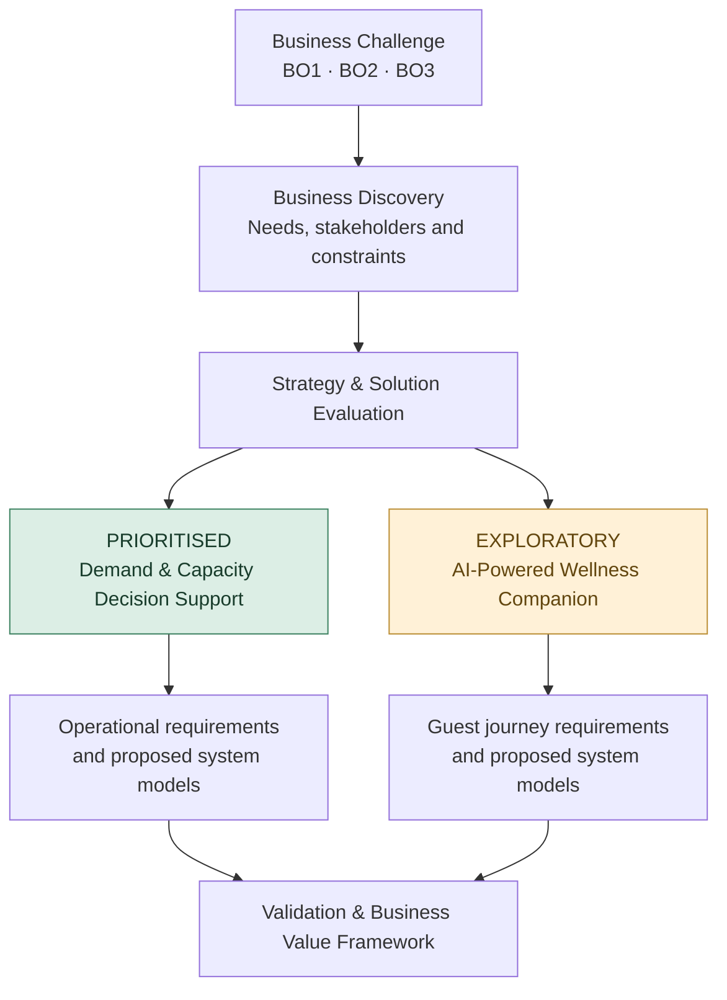
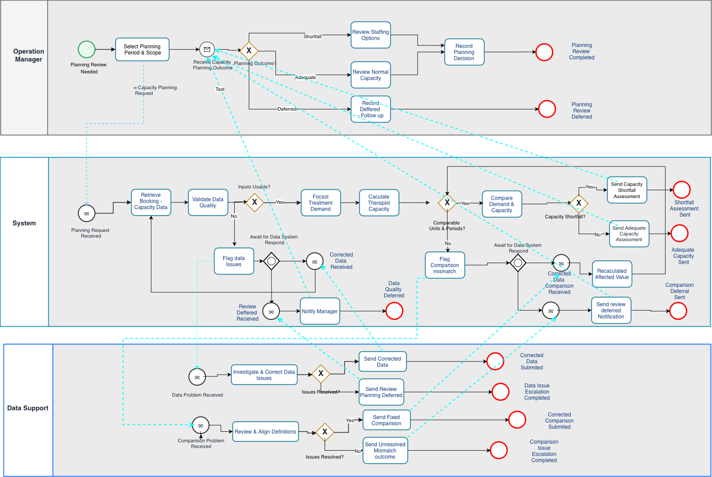
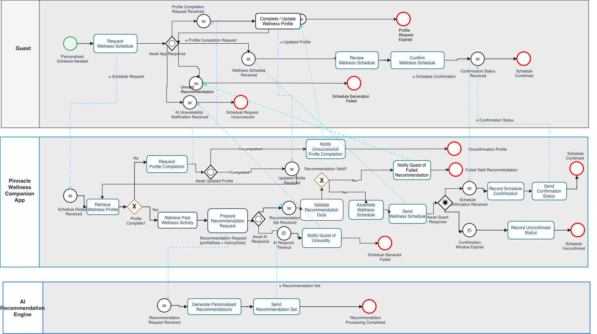

# Pinnacle Wellness Resort
### End-to-End Business Analysis | From Business Problems to Evidence-Based Solution Decisions

**Independent Business Analysis Portfolio · Deakin University Case Study · Melbourne, Australia · 2026**

`Business Discovery` · `Solution Evaluation` · `Requirements Engineering` · `BPMN & UML` · `UAT Planning` · `Business Value`

> **Project outcome:** Developed a five-stage Business Analysis case study, translating complex service-coordination challenges into prioritised solution opportunities, traceable requirements, proposed system designs and an evidence-based validation framework.

> **Project context:** Pinnacle Wellness Resort is a fictional academic business scenario. The portfolio demonstrates independent BA analysis and proposed solutions—not implemented software, completed stakeholder interviews, executed UAT or realised business benefits.

---

## 01 | The Business Challenge

Pinnacle Wellness Resort delivers premium, specialist-led wellness services across accommodation, treatments and nutrition.

However, its service model faces three interconnected challenges:

| Business challenge | Potential impact | Business objective |
|---|---|---|
| **Fragmented guest information** | Inconsistent access to information across service functions | **BO1:** Improve Guest Information Continuity |
| **Complex specialist scheduling** | Limited visibility of demand and therapist-capacity constraints | **BO2:** Improve Treatment Scheduling Efficiency |
| **Personalised service expectations** | Difficulty coordinating relevant and consistent guest experiences | **BO3:** Improve Personalised Guest Experience |

**The central BA question:**

*How can Pinnacle improve service coordination and planning while preserving specialist judgement, protecting guest information and avoiding unnecessary technology investment?*

The analysis treats this as a **business information and coordination problem**, rather than assuming that building an application is the solution.

---

## 02 | From Business Problem to Solution Strategy

The project evaluated strategic and operational opportunities before defining detailed solution requirements.

### Two Distinct Workstreams

| | Workstream A — Operational Priority | Workstream B — Exploratory Concept |
|---|---|---|
| **Solution** | Demand & Capacity Decision Support | AI-Powered Wellness Companion |
| **Business focus** | Treatment-demand forecasting and therapist-capacity planning | Guest information, AI-assisted recommendations and proposed wellness schedules |
| **Primary users** | Operations Manager and proposed Data Support participant | Guests, with conditional professional oversight |
| **Expected contribution** | Earlier visibility of potential capacity gaps and more informed planning decisions | More relevant, consistent guest-facing schedule experiences |
| **Decision status** | Prioritised for detailed requirements and further feasibility assessment | Retained for separate scope and feasibility evaluation |

**Key strategic decision:** Progress the operational planning opportunity first, while keeping the Companion App as an exploratory concept. The workstreams are **not designed as an integrated application**, and neither has been approved for implementation.

---

## 03 | My End-to-End BA Journey

The portfolio follows a five-stage analytical workflow.

| Stage | Key question | BA techniques and deliverables | Explore |
|---|---|---|---|
| **01 — Business Discovery** | What problem are we solving? | BACCM, problem-space analysis, stakeholder needs and business objectives | [View Stage 1](01-business-discovery.md) |
| **02 — Strategy & Solution Evaluation** | Which opportunity should we prioritise, and why? | SWOT/TOWS, opportunity assessment, feasibility considerations and strategic recommendations | [View Stage 2](02-strategy-and-solution-evaluation-updated.md) |
| **03 — Requirements Analysis** | What must the proposed solutions achieve? | Stakeholder-needs mapping, MoSCoW, user stories, acceptance criteria, business rules and traceability | [View Stage 3](03-requirements-analysis-and-prioritisation.md) |
| **04 — Business Process & Solution Modelling** | How should the proposed processes and interactions work? | To-Be BPMN, Use Cases, UML Sequence Diagrams and conceptual Domain Class Models | [View Stage 4](04-business-process-and-solution-modelling.md) |
| **05 — Validation & Business Value** | How would we verify solution suitability and evaluate its value? | Requirements validation, proposed UAT, KPI measurement framework, risk and pilot decision gates | [View Stage 5](05-proposed-validation-and-business-value.md) |

**Analysis approach:** Business need → Strategic choice → Testable requirements → Proposed behaviour → Evidence required for acceptance and value.

---

## 04 | Featured BA Artefacts

### Business Process Modelling — Two To-Be BPMNs

| Demand & Capacity Planning | Personalised Wellness Scheduling |
|---|---|
|  |  |
| Data validation, demand forecasting, capacity comparison, management decisions and exception handling | Wellness-profile validation, AI recommendation handling, proposed schedules, guest confirmation and expiry |

### Supporting System Models

| Model | Demand & Capacity | Wellness Companion |
|---|---|---|
| **Use Case Diagram** | [View](diagrams/03-demand-capacity-use-case.png) | [View](diagrams/04-wellness-companion-use-case.png) |
| **Sequence Diagram** | [View](diagrams/05-demand-capacity-sequence.png) | [View](diagrams/06-wellness-companion-sequence.png) |
| **Domain Class Diagram** | [View](diagrams/07-demand-capacity-domain-model.png) | [View](diagrams/08-wellness-companion-domain-model.png) |

The models describe **proposed business and system behaviour**, not developed applications or verified production architectures.

For design rationale, modelling assumptions and known limitations, see [Stage 4 — Business Process & Solution Modelling](04-business-process-and-solution-modelling.md).

---

## 05 | Key Business Analysis Decisions

This project goes beyond documenting requirements by addressing trade-offs, constraints and unresolved decisions.

| BA decision | Rationale | Business significance |
|---|---|---|
| **Prioritise demand/capacity planning** | Direct relevance to operational planning and specialist-capacity decisions | Focus detailed analysis on a practical operational opportunity |
| **Treat data reliability as a prerequisite** | Incomplete or stale data can produce misleading planning outputs | Prevent unsupported decisions based on unreliable information |
| **Separate forecasts from live availability** | Predicted treatment hours do not confirm available appointment slots | Avoid confusing planning intelligence with booking functionality |
| **Keep the Companion App exploratory** | Guest workflows, data permissions and recommendation safeguards remain unresolved | Prevent premature implementation commitments |
| **Preserve human accountability** | Managers and relevant professionals must retain responsibility for important decisions | Support practical and appropriately governed service delivery |
| **Define evidence before claiming value** | Proposed functionality does not demonstrate operational improvement | Establish a credible path toward future acceptance and benefits evaluation |

**A central finding:** The proposed solutions address selected aspects of BO2 and BO3, but neither fully resolves BO1's broader cross-service guest-information continuity challenge.

---

## 06 | Proposed Validation & Business Value

The final stage distinguishes three different evaluation questions:

| Evaluation layer | Key question | Portfolio output |
|---|---|---|
| **Design Validation** | Are the requirements, models and business rules consistent and testable? | Requirements-to-design traceability and open findings |
| **User Acceptance Testing** | Would a developed solution support real user needs and expected business behaviour? | Proposed UAT strategy and 12 test scenarios |
| **Business Value Evaluation** | Would using the solution improve operational or guest outcomes? | KPI framework, baseline requirements and future pilot evaluation criteria |

### Potential Business Measures

**Demand & Capacity**
- Planning review turnaround time
- Timely identification of potential capacity shortages
- Forecast accuracy against historical actuals
- Scheduling conflict rate as an indirect downstream measure

**Wellness Companion**
- Valid proposed-schedule generation rate
- Guest schedule confirmation rate
- Guest satisfaction with personalisation

These are **proposed measures**, not achieved results. No verified business baseline, executed UAT or pilot evidence is available.

[Explore Stage 5 — Validation & Business Value Evaluation](05-proposed-validation-and-business-value.md)

---

## 07 | Skills Demonstrated

| Competency | Portfolio evidence |
|---|---|
| **Business Problem Analysis** | BACCM, business context, stakeholder needs and problem definition |
| **Strategic Thinking** | SWOT/TOWS, option assessment, prioritisation and trade-off analysis |
| **Requirements Engineering** | Functional and non-functional requirements, user stories, INVEST refinement, MoSCoW and acceptance criteria |
| **Business Process Modelling** | To-Be BPMN workflows, exception paths and participant responsibilities |
| **Systems Analysis** | Use Case, UML Sequence and Domain Class Diagrams |
| **Requirements Traceability** | Business objectives linked to requirements, models and proposed acceptance tests |
| **UAT Preparation** | Proposed business test scenarios, expected outcomes and readiness criteria |
| **Business Value Evaluation** | KPI definitions, benefits measurement approach and conditional decision framework |

---

## 08 | Final Recommendation & Portfolio Outcome

### Recommended Next Steps for Pinnacle

**1. Advance Workstream A to data-readiness and feasibility assessment.**

Confirm historical booking-data quality, therapist availability, planning definitions and forecasting evaluation requirements before considering development.

**2. Retain Workstream B as a separately evaluated concept.**

Validate guest needs, authorised information use, recommendation suitability, specialist-oversight requirements and schedule-confirmation rules before deciding whether to invest in the app.

**3. Establish acceptance and benefits evidence before implementation decisions.**

Use business validation, future UAT and comparable operational measures to inform a **Proceed / Refine / Defer** decision.

### What This Project Demonstrates

The outcome is a **traceable, decision-oriented Business Analysis package** covering the journey from problem discovery to proposed solution validation.

It demonstrates how BA techniques can be connected to business objectives, user needs, operational decisions and future measures of value.

**Project boundary:** This is an independent academic case study and proposed design portfolio. It does not claim deployed software, stakeholder approval, executed testing or realised financial or operational benefits.

---

**Start exploring:** [Stage 1 — Business Discovery](01-business-discovery.md) · [Stage 2 — Strategy](02-strategy-and-solution-evaluation-updated.md) · [Stage 3 — Requirements](03-requirements-analysis-and-prioritisation.md) · [Stage 4 — Modelling](04-business-process-and-solution-modelling.md) · [Stage 5 — Validation](05-proposed-validation-and-business-value.md)
